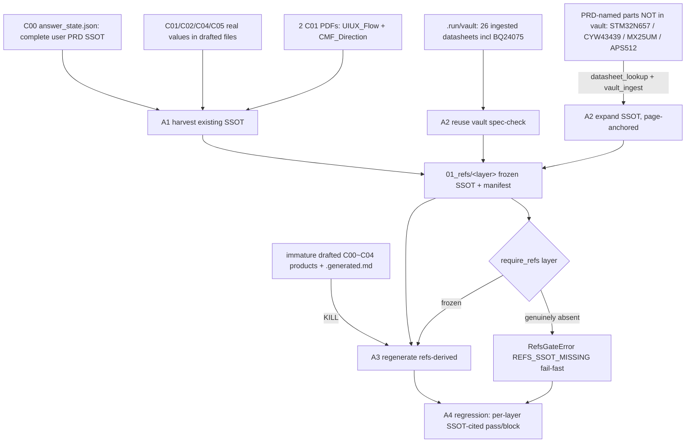

# Proposal: aiguard_refs-ssot-build

_語言：[zh-hant](./) · **en**_

> Auto-generated index for the `aiguard_refs-ssot-build` topic. Edit the source files; this README mirrors them. Do not edit this file directly.

## Status

**Verified** · 5 history entries · last advance 2026-07-04 (mode `promote` from implementing)

## Source artifacts

- [`proposal.md`](./proposal.md) — why this exists · modified 2026-07-04
- [`design.md`](./design.md) — architecture & decisions · modified 2026-07-04
- [`tasks.md`](./tasks.md) — checklist · 19/19 done (100%) · modified 2026-07-04
- [`idef0.json`](./idef0.json) + _no SVGs yet_ — formal functional decomposition
- [`grafcet.json`](./grafcet.json) + _no SVGs yet_ — formal runtime behavior
- `.state.json` — lifecycle state machine

## Why (excerpt)

- The graduated EPIC `capability/refs-derived-design` makes every C00~C04 generation
  stage **refs-derived**: it calls `require_refs(folder, layer)` and consumes a frozen
  `01_refs/<layer>/` SSOT instead of generating from nothing.
- aiguard is a **mature, SSOT-rich project** — NOT a greenfield. On disk today:
  - **C00** `answer_state.json` = a **complete, user-authored PRD SSOT** (12 sections +
    RF, every field `source:user`), naming **real parts**: STM32N657L0 SoC, BQ24075
    charger, LM66200/LM66100 power-path, Murata LBEE5KL1YN / CYW43439 radio, MX25UM-class
    octal NOR, APS512-class octal PSRAM, TPS62824 / TLV7xx rails.
  - **C01/C02/C04/C05** each already have constraint artifacts
    (`Interface_Constraints.json`, `Mechanical_Constraints.json`, `Layout_Constraints.json`,
    `Pin_Map_Bridge.json`) — currently in `drafted`/`draft` state (immature).
  - The **component vault** (`.run/vault/vault.db` + 26 datasheet PDFs) already holds
    **real ingested datasheets**, including PRD-named parts (BQ24075, TPS62824, TCR2LE33,
    TLV75733/TLV74018, W25Q128, nRF7002 …), harvested from
    `thesmart_products/.../c03-ee/01_refs/datasheets` + `refs/02.OpenMV`.
- The problem is NOT missing SSOT. It is that **C00~C04 have immature `drafted` products**
  and **no consolidated `01_refs/` SSOT** for the refs-derived gate to consume. This plan
  **harvests the existing SSOT, expands it with real datasheets, and redoes (kill+regen)
  the immature C00~C04 products refs-derived** — so aiguard can run a real full-chain
  regression.

[Full →](./proposal.md)

## Architecture overview

[Full design →](./design.md)

## Recent activity

- 2026-07-04: `promote` implementing → verified — refs-derived gate 5/5 PASS (C00-C04); 12 JSON jq-clean; C03-EE seeded; REGRESSION.md written; vault split fixed (BR_20260705). Remaining fields owner/external-gated (BLOCKED with named authority).
- 2026-07-04: `promote` planned → implementing — Approved to execute: harvest existing aiguard SSOT + datasheet expansion + kill-and-regen C00~C04 refs-derived
- 2026-07-04: `promote` designed → planned — tasks + handoff + all contracts complete; ready for new-session execution
- 2026-07-04: `promote` proposed → designed — IDEF0-first design + contracts complete
- 2026-07-04: `new` (initial) → proposed — initial spec created via plan-init.ts

<!-- AUTO-GENERATED by plan-builder MCP plan_sync · 2026-07-04T19:19:42Z · do not edit this file. -->
