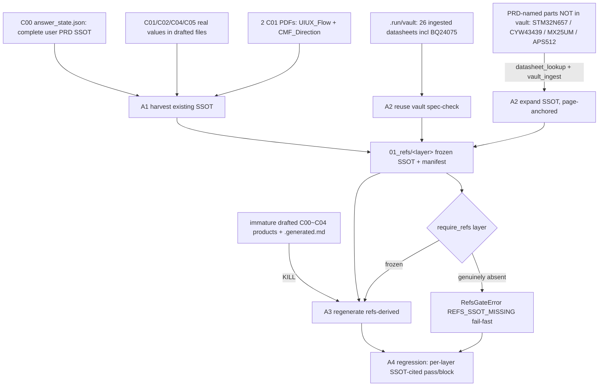

# Design: aiguard_refs-ssot-build

## Context

The graduated EPIC `capability/refs-derived-design` makes C00~C04 refs-derived: each
stage consumes a frozen `01_refs/<layer>/` SSOT via `require_refs`. aiguard is a mature
project — it already holds a complete user-authored C00 PRD (`answer_state.json`),
immature (`drafted`) C01/C02/C04/C05 constraint files, and a 26-datasheet component vault
(`.run/vault`, including PRD-named parts like BQ24075). What it lacks is a consolidated
`01_refs/` SSOT and a C03-EE stage; and its C00~C04 products are immature. This plan
**harvests the existing SSOT, expands it with real datasheets, and kills-and-regenerates
the immature products refs-derived**. It changes no production code.

## Goals / Non-Goals

**Goals**

- Consolidate existing SSOT (C00 PRD + C01/C02/C04/C05 real values + 2 C01 PDFs) into a
  frozen `01_refs/<layer>/` root with a per-layer manifest.
- Reuse already-ingested vault datasheets for PRD-named parts; expand the vault with real
  datasheets for PRD-named parts not yet present.
- Kill-and-regenerate the immature `drafted` C00~C04 products refs-derived.
- Add the C03-EE stage, grounded from PRD electrical + datasheet SSOT.
- Run the refs-derived regression; report per-layer, SSOT-cited pass/block.

**Non-Goals**

- Discarding existing user SSOT or vault datasheets.
- Fabricating any value from nothing.
- Touching the `living` EPIC modules or the placement-quality algorithm.

## Architecture

This architecture is hung on the IDEF0 skeleton (idef0.json): **A1** Harvest existing
SSOT, **A2** Reuse + expand datasheet SSOT, **A3** Kill-and-regen immature C00~C04
products (incl. new C03-EE), **A4** Run refs-derived regression. The flow below derives
from that A1→A2→A3→A4 decomposition, with the central distinction between **SSOT inputs**
(harvested + expanded, never discarded) and **generated products** (killed + regenerated).

## Decisions

- **DD-1: `01_refs/` is a consolidated SSOT, harvested — not built from scratch.** aiguard
  already has rich SSOT (user PRD + layer constraints + vault datasheets). `01_refs/`
  consolidates and freezes the *real* values from these existing sources; it does not
  re-invent them. Rejected (v1/v2): treating aiguard as a 2-PDF greenfield and auto-blocking
  layers — that discarded existing SSOT, violating the user constraint.
- **DD-2: SSOT input vs generated product — the load-bearing distinction.** *SSOT inputs*
  (C00 `answer_state.json` user fields, the 2 C01 PDFs, vault datasheets, real
  datasheet-grounded values inside the constraint files) are **harvested and preserved**.
  *Generated products* (the immature `drafted`/`draft` derivation in the constraint JSONs,
  `.generated.md`) are **killed and regenerated refs-derived**. Never confuse the two:
  don't preserve an immature product as-is, don't discard a real SSOT input.
- **DD-3: Reuse the vault first, expand second.** For every PRD-named part, check the vault
  (`bodesign_vault_spec_check`) before pulling. 26 datasheets are already ingested
  (BQ24075, TPS62824, TCR2LE33, TLV75733/TLV74018, W25Q128 …). Only pull+ingest datasheets
  for PRD-named parts genuinely absent from the vault (STM32N657L0, CYW43439/LBEE5KL1YN,
  MX25UM NOR, APS512 PSRAM …).
- **DD-4: SSOT expansion via datasheet is REQUIRED and is the opposite of fabrication.**
  During execution the agent SHALL pull real datasheets (`bodesign_datasheet_lookup` /
  `bodesign_vault_ingest`) to ground electrical/mechanical values. Fabrication (天条 2) =
  inventing a value from nothing; pulling a real page-anchored datasheet = grounding
  (天条 4). Follow the existing vault provenance convention (`01_refs/datasheets/<MPN>.pdf`).
- **DD-5: Every frozen value cites a source anchor.** A PRD-derived value cites its
  `answer_state.json` field id + section; a datasheet-derived value cites `{MPN, page}`.
  No un-sourced value enters `01_refs/` (天条 4).
- **DD-6: BLOCKED is narrow — only genuinely-absent SSOT.** A layer/field is
  `blocked_missing_source` ONLY when no PRD field, no existing constraint value, and no
  derivable datasheet supplies it (e.g. owner-only final coordinates, unassigned approvers,
  external compliance gates). `require_refs` fail-fasts on these (天条 1); they carry a
  status flag + named `required_authority`, never a phantom file (天条 2).
- **DD-7: Kill-and-regen, not in-place edit, for immature products.** The `drafted` C00~C04
  products are regenerated from the frozen `01_refs/` via the refs-derived stage generators,
  so the new product is provably derived from SSOT (not a hand-patched old draft). The old
  immature version is replaced, its real SSOT-inputs already harvested into `01_refs/`.

## Risks / Trade-offs

- **Risk: mistaking an immature product for missing SSOT (the v1/v2 error).** Mitigation:
  DD-2 — classify every existing file as SSOT-input (harvest) or generated-product (regen)
  before acting; when unsure, inspect `source`/`state` fields (`source:user` = SSOT input).
- **Risk: discarding a real SSOT value hidden inside a `drafted` file.** Mitigation: harvest
  the real `source:user` / datasheet-grounded values out of the constraint files *before*
  killing the immature derivation around them.
- **Risk: datasheet expansion pulls a wrong/near-miss part.** Mitigation: match against the
  exact PRD-named MPN; page-anchor every value; `bodesign_vault_spec_check` /
  `bodesign_rca_spec_audit` gate before use (天条 4). Honest rank-0 if no real match — no
  substring-fabricated authority.
- **Trade-off: consumer-side only** — no code change; surfaced EPIC gaps route back via
  `spec_amend` on the EPIC spec, not patched here.

## Critical Files

- `.work/aiguard/C00-PRD/answer_state.json` — complete user PRD SSOT (harvest source).
- `.work/aiguard/C01-ID/Interface_Constraints.json`, `C02-ME/Mechanical_Constraints.json`,
  `C04-Layout/Layout_Constraints.json`, `C05-FW/Pin_Map_Bridge.json` — immature products;
  harvest real values, then regen.
- `.work/aiguard/C01-ID/**/*.pdf` — the 2 C01 human-seed sources.
- `.run/vault/vault.db` + `.run/vault/blobs/**` — 26 ingested datasheets (reuse source).
- `packages/component-kb/bodesign_component_kb/vault.py` — vault spec-check / ingest engine.
- `services/mcp/vault_api.py` — `bodesign_vault_*` / `bodesign_datasheet_lookup` surface.
- `packages/workflow-core/bodesign_workflow_core/refs_gate.py` — `require_refs` (living, read-only).
- `packages/workflow-core/bodesign_workflow_core/upstream_constraints.py` — refs→constraint adapter (living, read-only).
