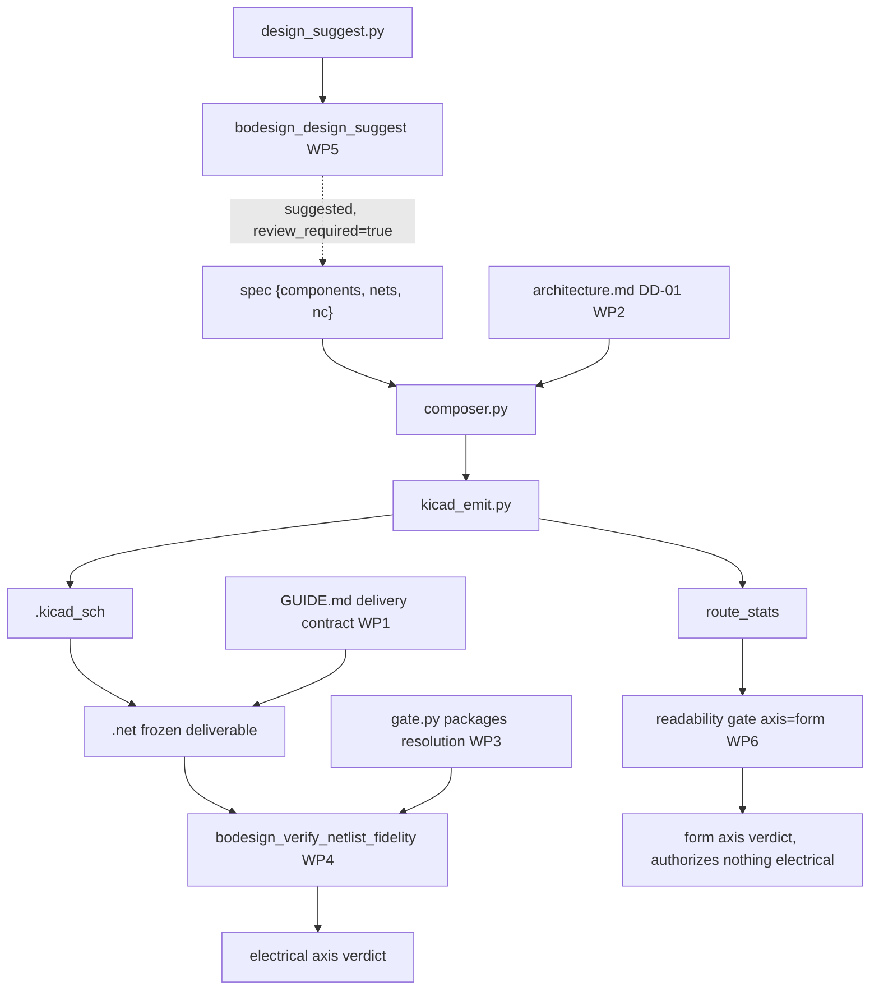

# Proposal: c03_delivery_contract_and_engine_seams

_語言：[zh-hant](./) · **en**_

> Auto-generated index for the `c03_delivery_contract_and_engine_seams` topic. Edit the source files; this README mirrors them. Do not edit this file directly.

## Status

**Implementing** · 4 history entries · last advance 2026-09-06 (mode `promote` from planned)

## Source artifacts

- [`proposal.md`](./proposal.md) — why this exists · modified 2026-09-06
- [`design.md`](./design.md) — architecture & decisions · modified 2026-09-06
- [`tasks.md`](./tasks.md) — checklist · 0/53 done (0%) · modified 2026-09-06
- [`idef0.json`](./idef0.json) + _no SVGs yet_ — formal functional decomposition
- [`grafcet.json`](./grafcet.json) + _no SVGs yet_ — formal runtime behavior
- `.state.json` — lifecycle state machine

## Why (excerpt)

- C03 accumulated 39 BRs between 2026-06-18 and 2026-09-05 and the symptom never
  moved: the first BR's title
  (`issues/closed/issue_20260618_compose_schematic_draftsman_quality.md`) and the
  latest one (`issues/BR_20260905_draftsman_connection_strategy_degenerates_to_label_farm_on_non_label_friendly_topology.md`)
  describe the same failure. 38 of the 39 landed in the drawing/verification
  layer; 1 touched design completeness, and its fix landed on a pipeline the
  delivery path does not execute.
- Root cause G (`docs/research/rca_20260906_c03_schematic_total_root_cause.md`
  §10.6): `skills/bodesign/stages/c03-ee/GUIDE.md` defines the C03 deliverable as
  a consolidated `.docx`. Of the four `MANDATORY` markers in that file, two
  (`:399` document consolidation, `:437` file naming) govern document appearance;
  the netlist row (`:392`) carries no `MANDATORY`, no bold, and no version-control
  requirement, and `:447-450` explicitly places `02_build/` **out of scope**. A
  consumer that shipped a docx and left `.kicad_sch`/`.net` untracked followed the
  GUIDE exactly.
- Root cause D/§5: two schematic pipelines exist and share no code. PC-001 — the
  only machine backstop for the pinout-to-circuit obligation table — lives in
  `skills/bodesign/engines/kicad/scripts/validation_detectors.py` (measured: 3
  files in `skills/`, **zero** files in `packages/` + `services/`). From
  `bodesign_compose_schematic` it can never run.
- Root cause B: `packages/eda-bridge/bodesign_eda_bridge/design_suggest.py` (756
  lines, KB-anchored, `review_required=True`) is registered in **no** MCP verb
  (measured: `design_suggest` count 0 in `services/mcp/server.py`).
- Root cause C/§10.3: the fidelity gate is reachable only through
  `compose_schematic`, has no concept of NC (`nc_`/`no_connect` zero hits in
  `fidelity.py`; control: 8 hits in `kicad_emit.py`), and a parsed-zero read can
  return `ok=True`.
- Root cause F/§10.4: `bodesign_check_c03` is registered (measured: 1 hit) yet a
  consumer reading the published skill cannot run it, because the projection ships
  no executable body.

[Full →](./proposal.md)

## Architecture overview

[Full design →](./design.md)

## Recent activity

- 2026-09-06: `promote` planned → implementing — WP1 (C03 delivery definition rewrite) dispatched to ses_f8a707824; order 1->4half->F->Q5->2->3
- 2026-09-06: `promote` designed → planned — tasks.md six WPs with positive/negative controls; ordering 1->4half->F->Q5->2->3 per user ruling 2026-09-06
- 2026-09-06: `promote` proposed → designed — RCA a54faf27 root causes A-G; six WPs drafted, DD-01..10 recorded, validate rc=0, dispatcher verified round 2
- 2026-09-06: `new` (initial) → proposed — initial spec created via plan-init.ts

<!-- AUTO-GENERATED by plan-builder MCP plan_sync · 2026-09-06T08:00:55Z · do not edit this file. -->
