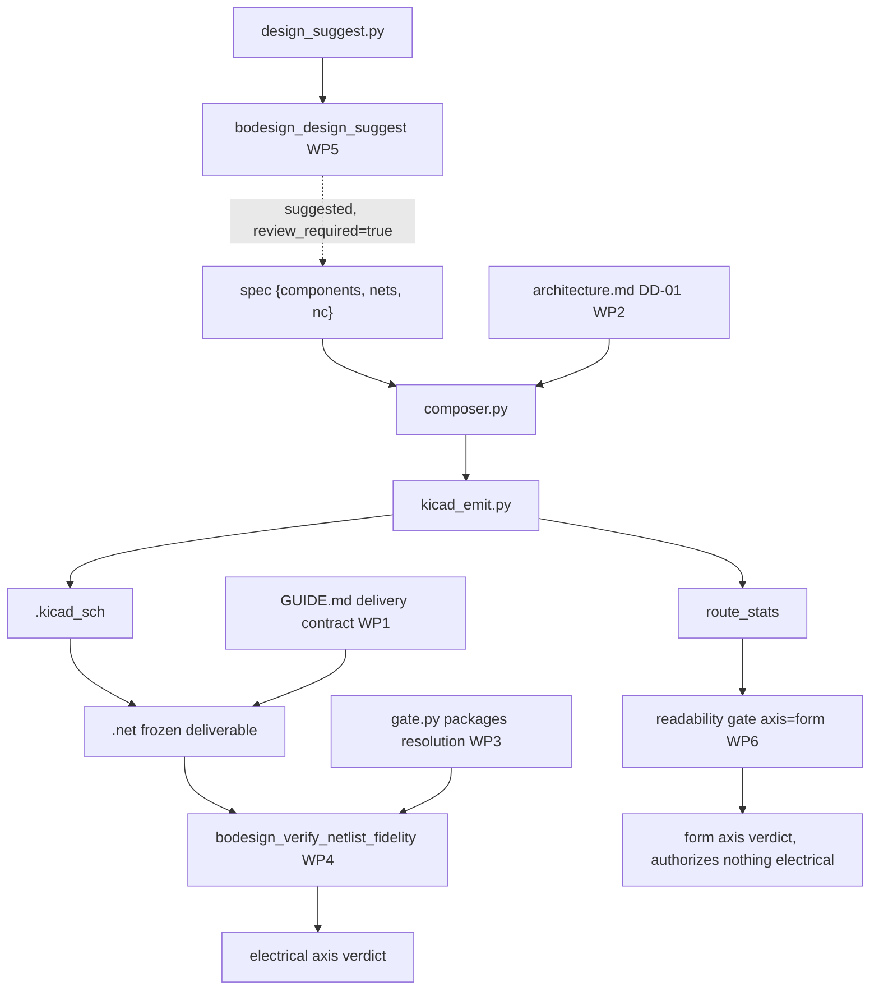

# Design: c03_delivery_contract_and_engine_seams

## Context

The architecture below is hung on the IDEF0 skeleton in `idef0.json`, which is
the authoring order: six activities, one per work package, each named here before
its design prose exists.

| IDEF0 | WP | activity | this document |
|---|---|---|---|
| **A1** | WP1 | Define C03 delivery contract | DD-05 (freeze artifact shape) |
| **A2** | WP2 | Adjudicate delivery pipeline | DD-01 (P1 delivers, P2 demoted), DD-08 (PC-001 → `check_c03.py`) |
| **A3** | WP3 | Resolve executable body for projected skill | DD-03 (false dichotomy), DD-04 (resolution order) |
| **A4** | WP4 | Verify netlist fidelity | DD-06 (unreadable input is indeterminate) |
| **A5** | WP5 | Suggest passive network | DD-02 (suggest is not decide) |
| **A6** | WP6 | Gate schematic readability | DD-07 (form axis authorizes nothing electrical), DD-09 (`N` is spec-derived), DD-10 (`route_stats` lacks both terms) |

Decision numbering: `DD-01`..`DD-10` are this file's identifiers. Each is
additionally appended to the specbase decision ledger by `spec_record_decision`,
which assigns its own monotonic sequence number; the `ledger:` line at the end of
a decision gives that number. The two numbering spaces are independent and are
not expected to agree.

The control flow wiring these six is `grafcet.json` steps 0..5, one per activity,
in the user-ruled execution order; each step's `Condition` is that WP's
positive-and-negative control pair from `tasks.md`.

Two schematic pipelines exist in this repo and share no code:

- **P1 (MCP, the delivery path from this package onward)** —
  `packages/eda-bridge/bodesign_eda_bridge/composer.py` → `kicad_emit.py` →
  `fidelity.py`, reached through `services/mcp/server.py`
  `bodesign_compose_schematic`.
- **P2 (skill, internal tool from this package onward)** —
  `skills/bodesign/engines/kicad/scripts/{symbol_4edge,host_from_pinmap,netlist_to_kicad_sch}.py`
  + `render_hybrid_sch.sh`.

The measured state this package starts from, each with the control that proves the
probe discriminates:

| measurement | value | control | control value |
|---|---|---|---|
| `PC-001\|passive_completeness` in `packages/`+`services/` | rc=1, 0 files | same pattern in `skills/` | 3 files |
| `"name": "bodesign_verify_netlist_fidelity"` in `server.py` | 0 | `"name": "bodesign_check_c03"` | 1 |
| `design_suggest` in `server.py` | 0 | (same file, `check_c03` row above) | 1 |
| `test -d ~/.local/share/opencode/skills/bodesign/packages` | rc=1 | `.../bodesign/scripts` | rc=0 |
| `test -d skills/bodesign/packages` (repo side) | rc=1 | `test -d packages` (repo root) | rc=0 |
| `MANDATORY` in `GUIDE.md` | 4 hits (`:199`, `:229`, `:399`, `:437`) | `ZZZNOTATOKEN` same file | 0 hits, rc=1 |
| `pintype "power_in"` in `experiments/aiguard_c03_verify/ccm.net` | 59 | `pintype "zzznope"` same file | 0, rc=1 |
| `RouteStats.to_dict()` keys (`composer.py:226-232`) | 4: `wired_nets`, `labelled_nets`, `junctions`, `label_fallback_reasons` | — | — |
| `opencode skill status bodesign` | `bodesign/bodesign: drifted (projection hand-edited)`, synced `2026-09-03T10:25:07.624Z` | same command, sibling skill | `bodesign/bodesign-kb: current`, synced `2026-07-04T15:32:05.747Z` |

The `drifted` reading is load-bearing for WP3: the published tree that WP3's
positive control runs against is **not** a faithful projection of this repo right
now, so WP3's first implementation step is `opencode skill resync bodesign
--accept-source` (AGENTS.md §3.2) — measuring the published tree before that
resync would measure a hand-edited artifact, not the repo.

The last row is new information this package produced, and it changes WP3's shape
— see DD-03.

## Goals / Non-Goals

**Goals**

- The C03 deliverable is a frozen, version-controlled netlist; the docx is its
  projection (WP1).
- The pipeline adjudication is written where implementers read it, with a per-item
  migration list rather than a slogan (WP2).
- A projected skill either runs its roster or reports `not-run` per verb (WP3).
- Fidelity is callable without `compose_schematic`, distinguishes `nc_wired` from
  `fused`, and cannot report `ok` from an empty read (WP4).
- `design_suggest` is callable, and its rule coverage extends from 3 topics toward
  the nine pin classes with a named KB anchor per class (WP5).
- Readability is measured on a `form` axis that authorizes nothing electrical (WP6).

**Non-Goals**

- Netlist synthesis (`concept.bodesign.netlist-synthesis-gap` stays open).
- Routing / anti-fusion geometry changes.
- Turning the real board's fidelity green (belongs to two other BRs).
- Deleting or rewriting the P2 scripts.

## Decisions

- **DD-01 — P1 is the C03 delivery path; P2 is demoted to an internal tool.**
  Evidence: RCA §3-D (no code relation between the two — `netlist_to_kicad_sch.py`
  imports only stdlib; `compose_schematic` appears in `skills/` only inside
  markdown and the gate facade) and RCA §5 (PC-001's fix landed entirely in
  `skills/`: measured 3 files there, 0 in `packages/`+`services/`, so from
  `compose_schematic` it never executes). User ruling 2026-09-06. Rejected
  alternatives: (a) merge the two pipelines — RCA §6 records four failed
  full-rewrite generations, so a fifth is not proposed; (b) keep both as delivery
  paths — that is the present state, and it is what let a fix be recorded as
  landed while the delivery path stayed unfixed. Consequence: every quality rule
  and every gate hangs on P1; P2 keeps working and is not deleted, but nothing new
  is attached to it.
  `ledger: spec_record_decision #8`

- **DD-02 — `design_suggest` may be exposed without crossing the
  `concept.bodesign.netlist-synthesis-gap` red line, because "suggest" and
  "decide" differ in the output contract, not in the caller's discipline.**
  The gap object's stated reason is avoiding silent fabrication of nets. Four
  properties, each mechanically checkable, keep the exposure on the safe side:
  (1) `status` ∈ {`suggested`, `no-rule`, `indeterminate`} — `committed` is not a
  member of the codomain, so no input can produce it;
  (2) `review_required` is a constant `true` asserted by test, not merely set by
  convention;
  (3) every numeric value carries an `evidence` block naming the KB object id, the
  formula and the provenance — a class with no KB rule returns `no-rule` and no
  value, so an unsourced number cannot be produced;
  (4) the verb writes no files and does not mutate the spec — the caller merges the
  fragment by hand.
  The gap stays open and this verb does not narrow it: it produces *drafts a
  reviewer commits*, which is a different artifact from a synthesized netlist.
  Rejected alternative: keeping `design_suggest` unexposed until synthesis is
  solved — the measured cost of that choice is that the module has existed since
  commit `d1ab7fd` with its own unit test as its only caller.
  `ledger: spec_record_decision #9`, amended by `#11` (implementation round,
  2026-09-06). The amendment sharpens property (3) and adds one finding the
  design stage could not have had: an anchor that states an OBLIGATION is not an
  anchor that states a VALUE. `step.sch.mcu-adc-frontend-review` carries only the
  former, so analog-reference is implemented and still cannot reach `suggested` —
  see §"The two anchors are NOT equally usable". Property (3) is now tested by
  resolving each `kb_object` against `.specbase/ragbase.sqlite` with a
  fabricated-id control, because asserting the field is non-empty would pass for
  an invented id — the exact failure the property exists to catch.

- **DD-03 — WP3's premise from RCA §10.9 #6 ("is excluding `packages/` deliberate
  or an oversight?") is a false dichotomy; the measured answer is a third one.**
  `mcp.json:14-16` declares `skillPaths: ["skills"]`, so the projection unit is
  `skills/<name>/`. `test -d skills/bodesign/packages` is rc=1 **in the repo
  itself** (control: `test -d packages` at the repo root, rc=0): `packages/` is not
  a member of the projected subtree, so it is not *excluded from* a list — it is
  structurally outside the unit being projected. No edit to a projection manifest
  can add it, so option (a) of the dispatch order ("add `packages/` to the
  projection list") is not implementable as stated; it would require either
  vendoring a copy under `skills/bodesign/packages/` (a second copy of the engine
  — the `consumer fork drift` shape `specs/architecture.md:75` already names) or
  redefining `skillPaths`, which changes what every other skill ships.
  **Chosen: option (b)** — resolution inside `gate.py`, detailed in DD-04.

- **DD-04 — `gate.py` resolution order under an XDG install is `BODESIGN_SRC` → a
  fixed enumerated candidate list → typed `packages_error`; there is no third tier
  and no silent fallback.** `gate.py:75-102` `_resolve_src()` today tries
  `$BODESIGN_SRC`, then walks up from its own location, then raises
  `LANDING_PACKAGES_NOT_FOUND`. The walk-up cannot succeed under XDG because the
  projected tree has no ancestor containing `packages/workflow-core`. The added
  tier is a **literal list** of candidate repo roots (not a glob, not a search):
  each candidate is accepted only if `packages/workflow-core` exists under it, and
  the accepted candidate is reported in `packages_root` so the caller can see which
  one answered. If none match, `packages_resolved=false` and `packages_error` keeps
  its current typed shape (`code`/`message`/`hint`/`impact`) — `gate.py:829-844`
  already emits exactly those fields and `gate.py:849` already states the
  discipline ("TRUE PROVES ONLY THAT packages/workflow-core RESOLVED"), so WP3
  extends a working disclosure rather than building one. Rejected alternative:
  searching the filesystem for any directory named `packages/workflow-core` — that
  is a fallback that can bind to a stranger's checkout, which AGENTS.md 天條 1
  forbids.

- **DD-05 — the frozen netlist deliverable is `<stage>/C03_<product>.net`, and the
  `02_build/` exclusion at `GUIDE.md:447-450` is narrowed rather than deleted.**
  The freeze artifact is a *copy promoted to the stage root* under the existing
  `C03_` prefix rule, not a relaxation of the prefix rule and not a blanket
  tracking of `02_build/`. Two files are promoted and tracked: the merged `.net`
  and a `C03_Netlist_Freeze.json` recording, per emitted `.net`, its sha256, the
  `nets_parsed` count, the emitting revision, and the WP4 verdict. Rejected
  alternative: tracking `02_build/` wholesale — that pulls in scratch and rendered
  intermediates, and the RCA's finding was not "too little is tracked" but "the
  electrical truth is not a deliverable".

- **DD-06 — a fidelity input that cannot be read yields `indeterminate`, and
  `indeterminate` is not reachable from `ok`.** `fidelity.py:216-221` currently
  swallows a per-sheet `kicad-cli` export failure with a bare `continue`; the
  parsed-zero path then produces `ok=True` whenever the spec has only single-pin
  nets (RCA §10.3(c)). The new verb never re-derives `ok` from a read it cannot
  vouch for: `nets_parsed == 0`, or any `emitted` path unreadable, sets
  `status="indeterminate"` **before** any comparison runs. This is the WP4 negative
  control's target.

- **DD-07 — WP6 reports on axis `form` and its report carries
  `does_not_authorize:["electrical_correctness"]`; the field is a required output,
  not documentation.** BR_20260905 §8.5.2 measured a change that improved every
  geometric criterion (junction 5→43, stub share 73.0%→32.7%, subcircuits 3→11)
  while raising fidelity `moved` from 10 to 67 — it wired an open circuit. A
  geometry gate that could be read as an electrical verdict would have passed that
  change. Emitting the disclaimer as data means a consumer aggregating gate reports
  cannot drop it by reformatting prose.
- **DD-08 — PC-001 relocates to `check_c03.py` (Candidate A); the
  `specs/architecture.md:101` veto premise is measurably false as of R5–R8.**
  That line rejects `check_c03` with "BOM CSV, cannot see whether a cap is
  *connected* to a rail". It was true when PC-001 was designed (2026-07-23) and
  `check_c03` was BOM-only. It is not true now. Four primitives in
  `check_c03.py` answer exactly that question at pin level:
  `_netlist_pin_nets` (`:621`) returns `{ref: {pin: net_name}}`;
  `_netlist_pin_functions` (`:764`) returns `{ref: {pin: pinfunction}}`;
  `_polarity_of` (`:651`) classifies a net name as `gnd` / `power` / `None`;
  `_nets_to_refs` (`:793`) inverts to `{net: {refs}}`. R7
  `_check_mandated_passives` (`:924-934`) already composes them into the literal
  rail walk — resolve the FB pin's net, take the refs attached to that net,
  partition into `resistors` / `caps`, and report what is missing. "Is this cap
  connected to that rail?" is the query R7 already runs. `check_c03` also already
  receives `netlist_path` (`:1082`) as a first-class parameter with `not_run`
  discipline (`:1183-1206`), and it is already an MCP verb on the delivery path.
  Input adequacy is measured, not assumed: on `experiments/aiguard_c03_verify/ccm.net`,
  `pintype` appears 637×, `pinfunction` 489×, `pintype "power_in"` 59× (control:
  `pintype "zzznope"` = 0, rc=1), so the power-pin identification PC-001 needs is
  present in the emitted artifact, not only in the `.kicad_sch`.
  Rejected alternative: the composer entry. It is reachable and does see nets, but
  it would have to re-implement `classify_component` → `ic` and the power/ground
  net classification that `check_c03` already owns — the original veto's *stated
  reason* (re-implementing classification) survives for the composer even though
  its parallel claim about `check_c03` does not.
  Consequence for `check_c03.py`: `_NOT_CHECKED_BASE:1010` `decoupling_adequacy`
  must move to the conditional form R7/R8 already use (`_build_not_checked:1024`),
  so a PC-001 that did not run stays listed rather than dropping out of the
  disclosure.
  `ledger: spec_record_decision #11`

- **DD-09 — WP6's `N` is derived from the spec, not a constant, and the threshold
  on `drawn_subcircuits / N` is pinned by measurement in the implementation task,
  not in this document.** Definition (user ruling 2026-09-06):
  `N := the number of signal nets in the spec that contain at least one passive
  (a component whose ref prefix is R, C or L) and whose node count is in [2, 6]`.
  Power and bus nets are excluded by the same `net_kinds` classification
  `_build_route_stats` (`composer.py:1790`) already applies, so `N` counts the
  nets that *could* be drawn as a local subcircuit. The gate measures the ratio
  `drawn_subcircuits / N`; the numerator's emission point is WP6's prerequisite
  task 6.0 (see DD-10). The threshold value is deliberately absent here: it is set
  by task 6.4 from the btdongle real board, then frozen, then negatively controlled
  against the BR_20260905 §8.5.2 power-clustering fixture, which must still pass
  the form gate while carrying `does_not_authorize`. Writing a number here before
  that measurement would be the §8.5.5 scale-dependence error in advance.
  `ledger: spec_record_decision #12`

- **DD-10 — `route_stats` does not today carry either quantity WP6 needs, so WP6
  gains a prerequisite emission task rather than an assumption.** Measured:
  `RouteStats` (`composer.py:220-232`) has exactly four fields — `wired_nets`,
  `labelled_nets`, `junctions`, `label_fallback_reasons` — and `to_dict()`
  (`:226`) emits exactly those four keys. There is no stub-length term and no
  subcircuit count; `junctions` is `max(0, len(resolvable) - 2)` summed over wired
  nets (`:1830`), which is a fan-out proxy, not a count of drawn subcircuits.
  Therefore `stub_share` and `drawn_subcircuits` are **new emissions** owned by
  task 6.0, added to `RouteStats` and to `to_dict()` together (a field present on
  the dataclass but absent from `to_dict()` would be invisible to the gate while
  looking implemented). Their emission points are listed in `errors.md`
  §Outcome Codomain. Rejected alternative: deriving both post-hoc from the
  `.kicad_sch` — that reads the emitter's output through a second parser and
  reintroduces the drift the `label_nets`-passing comment at `:1790` explicitly
  removed.
- **DD-02 amendment (implementation round, 2026-09-06)** — recorded in the event
  ledger as `spec_record_decision #11`. This file keeps DD-01..DD-10 as its
  numbering; #11 is the ledger's running sequence for the same DD-02, not an
  eleventh decision. Substance: the four DD-02 properties survive contact with the
  implementation, with property (3) sharpened from "carries an `evidence` block"
  to "carries a `kb_object` that RESOLVES against `.specbase/ragbase.sqlite`",
  tested with a fabricated-id control — a non-emptiness assertion would pass for
  an invented id, which is the exact failure the property exists to catch. One
  finding the design stage could not have had: **an anchor that states an
  OBLIGATION is not an anchor that states a VALUE**, so a class can be covered and
  still be unable to reach `suggested` (§"The two anchors are NOT equally usable").
  Implemented: `power` (`suggested`) and `analog-reference` (`indeterminate`
  always). Real-board figures and the annotation limit behind the seven
  zero-subject results are in §"WP5 real-board measurement".

## WP5 KB coverage — measured, not assumed

Queried 2026-09-06 through `gate.ts ragbase_query`, each class against both tiers
(`--repo /home/pkcs12/projects/bodesign` for the repo tier, `--repo
$HOME/projects/ragbase` for the central tier). `fallbackApplied=true` means the
`and-tokens` plan returned zero and the runner degraded to `or-tokens`; per RCA §8
item 14 an or-degraded hit satisfies **one** token, not the query, so it is
recorded as **not a hit**. Queries use ≥3-character English body words: per
BR_20260906 §7 the trigram index returns 0 for 2-character Chinese terms and
`objectId` is UNINDEXED, so a query aimed at an id would return a false zero.

| pin class | query | tier | matchMode | fallbackApplied | verdict |
|---|---|---|---|---|---|
| Ground / exposed pad | `ground plane decoupling return` | repo | `and-tokens` | false | `control.rf.transmission-line-ground`, `concept.pcb.layout-scoring-rubric` — **both RF/layout scope, neither a ground-pin obligation rule → no anchor** |
| Ground / exposed pad | `ground plane decoupling return` | central | `and-tokens→or-tokens` | **true** | `none` (degraded) |
| Reset / EN | `reset enable pin pull-up` | repo | `and-tokens` | false | `workflow.sch.datasheet-contract-review` — a review *workflow*, not a sizing rule → **no anchor** |
| Reset / EN | `reset enable pin pull-up` | central | `and-tokens→or-tokens` | **true** | `none` (degraded) |
| Boot / strapping / config | `boot strapping strap configuration resistor` | repo | `and-tokens→or-tokens` | **true** | `none` (degraded) |
| Boot / strapping / config | `boot strapping strap configuration resistor` | central | `and-tokens→or-tokens` | **true** | `none` (degraded) |
| Analog reference | `analog reference voltage filtering` | repo | `and-tokens` | **false** | **`step.sch.mcu-adc-frontend-review`** — sole non-degraded hit |
| Analog reference | `analog reference voltage filtering` | central | `and-tokens→or-tokens` | **true** | `none` (degraded) |
| NC / DNC / reserved | `no connect unused pin` | repo | `hybrid` | false | `control.pcb.erc-zero-error-gate`, `concept.sch.pin-level-datasheet-contract`, `step.sch.dcdc-review-checklist` — an ERC gate, a general pin-contract concept, a DC-DC checklist; **none states an NC/DNC tie obligation → no anchor** |
| NC / DNC / reserved | `no connect unused pin` | central | `hybrid→or-tokens` | **true** | `none` (degraded) |
| CONTROL | `zzqqxx nonexistent token` | repo | `and-tokens` | false | repo `0` hits — the probe can return empty, so a zero above is a measurement rather than a broken query |

The control row is what makes the four `no anchor` verdicts readable: the same
runner, same tier, returns 0 for a nonsense query, so "no anchor" is not "the
query mechanism is down". (The control's `user` tier returned 1 —
`tooling-failmodes.failure-mode.ragbase-query-multi-token-silently-falls-back-to-or-tokens`
— because its title literally contains the failure mode being controlled for; that
is a title-substring hit on the central tier, not a repo-tier hit, and does not
weaken the repo-tier zero.)

**Consequence for the WP5 contract.** Two classes are implementable beyond the
three already shipped: Power/decoupling (`control.power.decoupling-pdn-strategy`,
carried from RCA §3-B) and Analog-reference (`step.sch.mcu-adc-frontend-review`,
measured above). Four classes — Ground, Reset-EN, Boot-strapping, NC-DNC — have no
anchor and are therefore the classes for which `bodesign_design_suggest` returns
`status="no-rule"`. This is not a gap to be filled by writing a rule from memory:
under DD-02 property (3) a class with no KB object may not produce a value, so
`no-rule` is the contractually correct output, and the negative control in task 5.8
targets exactly one of these four.

**Extension order** (task 5.5): anchor-bearing classes only, ordered by pins
governed on a typical board — (1) Power/decoupling (every VDD/VCC/AVDD/VBAT pin on
every active part), (2) Analog-reference (VREF/VRES, typically 1–3 pins on parts
that have an ADC at all). The three already implemented (I²C pull-up, crystal load
caps, series termination) are not re-ordered.

### The two anchors are NOT equally usable — measured 2026-09-06

The coverage table above answers *does an anchor exist*. Implementation forced a
second question the table does not ask: **does the anchor carry a VALUE?** The two
surviving classes answer it differently, and that difference decides their arms.

| anchor | confidence | what the body actually contains | can it yield a value? |
|---|---|---|---|
| `control.power.decoupling-pdn-strategy` | `verified` | a literal checker: 0.1µF per 2 power pins, ~15µF bulk per 10 power pins, decoupling ≤1.25cm, TI SPRABV2 | **yes** — `suggested` |
| `step.sch.mcu-adc-frontend-review` | `partial`, `extraction_status=raw-only` | one obligation sentence: *"VREF/analog-supply pins get required filtering and grounding"* — no capacitance, no formula, no validated window | **no** — `indeterminate` |

Read in full from `.specbase/ragbase.sqlite` (`ragbase_objects`, 1196 chars for the
ADC object), with a control: `SELECT` on a fabricated id returns no row, so the
absence of a formula is a reading of the object rather than a failed query.

**Consequence.** Analog-reference is implemented but can never reach `suggested`.
Emitting the customary 100nF would attach a REAL KB id to a number the object does
not contain — worse than no answer, because the evidence block would make the guess
look sourced. The arm therefore returns `indeterminate` and names the obligation,
which is real information (this pin needs filtering) without being a value. Under
DD-02 property (3) an anchor that states an obligation is not an anchor that states
a value, and the codomain already had the right cell for that distinction.

### WP5 real-board measurement — `experiments/aiguard_c03_verify/ccm.net`

Parse controls first, because the first attempt produced a confident wrong number:
a regex whose block-body lookahead never matched reported `U* refs = 0` against 281
net blocks — a zero from a broken pattern, indistinguishable in shape from a board
with no ICs. Re-measured with a sequential line scan and each count cross-checked
against a raw token count: nets 282, nodes 637 (raw `(node ` = 637), `power_in` 59
(raw `pintype "power_in"` = 59), control `ZZZ*` refs = 0.

| ref | `power_in` pins | status | 0.1µF | bulk | kb_object |
|---|---|---|---|---|---|
| U1 | 55 | `suggested` | 28 | 6 | `control.power.decoupling-pdn-strategy` |
| U2 | 4 | `suggested` | 2 | 1 | `control.power.decoupling-pdn-strategy` |
| U3, U5, U6, U7, U8, UB1, UW1 | 0 | `no-rule` (zero-subject arm) | — | — | anchor named in `evidence` |

Totals: 30 × 0.1µF, 7 × 15µF bulk across 9 U\* refs; distribution `suggested`×2,
`no-rule`×7. No class returned `indeterminate` on this board, and no VREF/AREF net
exists in `ccm.net`, so the analog-reference arm has **no real-board exercise** —
stated rather than inferred from its absence in the table.

**Why 7 of 9 ICs report zero power pins — diagnosed, not left as a number.** Their
pins carry `pintype` `unspecified` or `passive`, never `power_in`: U3 24 pins
(15 unspecified / 9 unspecified+no_connect), UB1 65, UW1 49, U5 6, U6/U7/U8 4–6
passive. Only U1 (55 `power_in`) and U2 (4) annotate supply pins at all. So the
seven `no-rule` results are a property of **this netlist's annotation**, not of the
parts — the same limitation that put 7 ICs in PC-001's
`ics_without_identifiable_rail` (WP2 round 3d). The zero-subject arm is the correct
output for them (a rule ran, the context named no pins of the class), and it is
distinguishable from an uncovered class because `evidence` is populated. What it is
NOT is evidence that those parts need no decoupling.

## WP3 candidate roots and the projection's current state

The DD-04 candidate list is a **literal two-entry list**, ruled 2026-09-06:

1. `/home/pkcs12/projects/bodesign`
2. `$HOME/projects/bodesign`

They denote the same path for the current uid; the second exists so a deployment
under a different uid resolves without an edit. No third entry, no glob, no
filesystem search. Each candidate is accepted only if `packages/workflow-core`
exists beneath it, and the accepted one is reported in `packages_root`.

Measured projection state (`opencode skill status bodesign`, read-only,
2026-09-06):

- `bodesign/bodesign: drifted (projection hand-edited — skill resync --accept-source)`, synced `2026-09-03T10:25:07.624Z`
- `bodesign/bodesign-kb: current`, synced `2026-07-04T15:32:05.747Z`

The sibling `current` row is the control: `drifted` is a per-skill verdict the
command can distinguish, not a blanket state. Because the published `bodesign`
tree is hand-edited, WP3's positive control (`bodesign_check_c03` runs under the
published skill) must be preceded by `opencode skill resync bodesign
--accept-source`; running it first would measure the hand-edited artifact instead
of the repo.

## WP1 — MANDATORY distribution, measured

`grep -n MANDATORY skills/bodesign/stages/c03-ee/GUIDE.md` returns exactly 4 lines
(control: `ZZZNOTATOKEN` on the same file, 0 hits, rc=1):

- `:199` §3b Vault-Absent Substitution Protocol
- `:229` §3c BOM 提案必讀清單 + SSOT 衝突自查段
- `:399` Document consolidation rule (single-doc + `img/`)
- `:437` File-naming rule — `C03_` prefix

None of the four attaches to the netlist. Two (`:399`, `:437`) are document-shape
rules, which is the §G finding stated as a count.

The whole file was read for a second deliverable definition. There are exactly two
places that define what C03 owes: `## Required deliverables — Definition of Done`
(`:25-61`, the 10-row table) and `## Deliverables` (`:379`), with `### 7. Export
the deliverable tables` (`:350`) as the SOP step that produces them. `:81-380` and
`:511-568` were read in full: `:514` *Handoff to C04 and C06* lists what is
exported downstream (it names "the verified **netlist**" — the closest thing to a
netlist obligation anywhere in the file, and it is a handoff clause, not a
deliverable row) and `:532` *Tools & companion skills* is a tool index. **No third
deliverable definition exists**, so WP1 edits two tables and one SOP step, not an
unbounded set.

Row 5 of the DoD table is `Netlist | ..._網路表.xlsx / .net | full, or honest
subset` — unbolded, alternative-formatted, and qualified by "or honest subset".
Row 3 (`Schematic`) points at `generated/sch*/*.kicad_sch`. Neither row states a
freeze, a hash, or version control, which is precisely the WP1 defect.

## Risks / Trade-offs

- **Demoting P2 orphans PC-001, the only passive-completeness backstop that
  exists.** Until WP2's migration item lands, the delivery path has no
  passive-completeness check at all — a regression relative to a consumer who
  happened to run `analyze_schematic.py`. Mitigation: WP2 carries the PC-001
  relocation as a blocking item, not an optional one, and WP2's negative control is
  precisely the current state (0 hits in `packages/`).
- **WP1 changes the definition of done for in-flight consumer deliveries.** A
  delivery already accepted under the old contract becomes retro-incomplete.
  Mitigation: WP1 states the contract change is forward-looking and names the one
  artifact (`C03_Netlist_Freeze.json`) a past delivery must add to become
  conformant, rather than invalidating the docx.
- **WP5 widens a suggestion surface while the synthesis gap stays open**, so a
  caller may read a `suggested` block as an approval. Mitigation: DD-02's four
  properties, of which (1) and (2) are enforced by the codomain and by test rather
  than by wording.
- **WP6's thresholds are calibrated on one board.** BR_20260905 §8.5.5 measured
  that a 28/21 synthetic corpus reports false non-compliance where the real 45/27
  board is comfortably compliant. Mitigation: thresholds are declared
  scale-dependent and the acceptance corpus is pinned to the real spec; a synthetic
  corpus may only supplement.
- **WP3's candidate list is a hand-written list** — the V4-c shape
  (`specs/architecture.md:75`), where a list drifts from what it enumerates.
  Mitigation: a test re-derives the expectation rather than restating the list, and
  a candidate that does not exist is skipped without changing the reported error.

## Critical Files

- `skills/bodesign/stages/c03-ee/GUIDE.md` — WP1. `:36-47` deliverable table,
  `:392` netlist row, `:396` the only bolded row, `:399-435` the 37-line docx
  section, `:437-452` naming rule with the `02_build/` exclusion at `:447-450`,
  `:454-494` gate/done criteria.
- `specs/architecture.md` — WP2. `:100-104` is where C03's terminus is currently
  described as two report JSONs; DD-01 and the migration list land here.
- `skills/bodesign/engines/kicad/scripts/validation_detectors.py` — WP2. PC-001's
  current home (`:1136` per the RCA); the source side of the relocation.
- `packages/workflow-core/bodesign_workflow_core/check_c03.py` — WP2 target
  candidate. `:744-762` `_MANDATED_PASSIVES` holds two MPNs, so R7 is a two-entry
  table rather than a pin-class engine; `:1010-1022` `_NOT_CHECKED_BASE` is the
  scope disclosure a relocated PC-001 must update.
- `skills/bodesign/scripts/gate.py` — WP3. `:75-102` `_resolve_src()` is the
  resolution order; `:829-844` the three disclosure fields; `:849` the discipline
  note DD-04 extends.
- `packages/eda-bridge/bodesign_eda_bridge/fidelity.py` — WP4. `:181`
  `parse_net_file` is the `.net` primitive; `:380` `compare_partitions` is the pure
  comparison; `:216-221` the swallowing `continue`; `:454` `verify_partition_fidelity`
  is the entry point whose `.kicad_sch` parameter blocks a `.net` caller.
- `packages/eda-bridge/bodesign_eda_bridge/design_suggest.py` — WP5. `:205`
  `suggest_i2c_pullups`, `:445` `suggest_series_termination`, `:642`
  `suggest_crystal_load_caps` are the three public entry points today.
- `services/mcp/server.py` — WP4/WP5. Handler and schema are two separate
  registration sites; `:1133` `"spec": {"type": "object"}` is the opaque schema.
- `packages/eda-bridge/bodesign_eda_bridge/composer.py` — WP6 input. `:281`/`:2600`
  `route_stats`, `:1790` `_build_route_stats`, `:2611-2621` the reconciliation that
  makes `wired_nets`/`labelled_nets` mirror actual emission.
- `skills/bodesign/stages/c03-ee/references/schematic-drawing-rules.md` — WP2/WP6.
  106 lines, 8 rules, written for P2; each rule needs an owner under DD-01.
- `skills/bodesign/stages/c03-ee/references/pinout-to-circuit-method.md` — WP5.
  `:32-47` is the nine-class pin obligation table.
- `issues/BR_20260905_draftsman_connection_strategy_degenerates_to_label_farm_on_non_label_friendly_topology.md`
  — WP6 thresholds. §8.5.1 real-board baseline, §8.5.2 the false-green
  counterexample, §8.5.5 the scale dependence.
