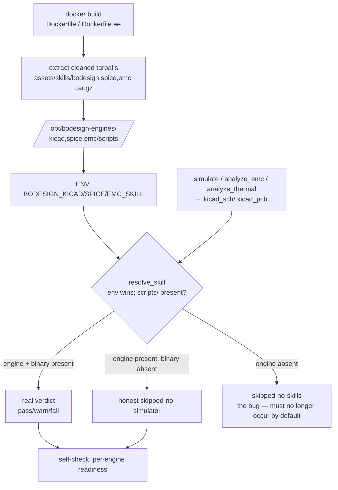

# Proposal: deployment_c06-analyzer-engines-in-container

_語言：[zh-hant](./) · **en**_

> Auto-generated index for the `deployment_c06-analyzer-engines-in-container` topic. Edit the source files; this README mirrors them. Do not edit this file directly.

## Status

**Implementing** · 4 history entries · last advance 2026-06-22 (mode `promote` from planned)

## Source artifacts

- [`proposal.md`](./proposal.md) — why this exists · modified 2026-06-22
- [`design.md`](./design.md) — architecture & decisions · modified 2026-06-22
- [`tasks.md`](./tasks.md) — checklist · 14/16 done (88%) · modified 2026-06-22
- [`idef0.json`](./idef0.json) + [idef0.A0.svg](./idef0.A0.svg) — formal functional decomposition
- [`grafcet.json`](./grafcet.json) + [grafcet.svg](./grafcet.svg) — formal runtime behavior
- `.state.json` — lifecycle state machine

## Why (excerpt)

- bodesign's three C06 verification tools — `bodesign_simulate`,
  `bodesign_analyze_emc`, `bodesign_analyze_thermal` — resolve their analyzer
  engine at runtime via `resolve_skill(name, BODESIGN_*_SKILL, ...)`. The Docker
  images bundle the **binary toolchain** (kicad-cli, pcbnew, ngspice) but **never
  the analyzer engine scripts** and set **no `BODESIGN_*_SKILL` env**. So all three
  tools return `skipped-no-skills` in every default deployment, and C06
  SPICE/EMC/thermal is **structurally unable to run** — permanently stuck at
  `not-run`.
- The honesty model forbids fabricated verdicts, so the *only* way to advance C06
  is to let the tools actually run. With no engine in the container, "reliability
  is shown, not asserted" cannot be satisfied — there is no path to *show*.
- The failure signal (`skipped-no-skills`) is honest but **non-actionable from
  inside bodesign**: env + mounts are deployment-layer, not tool parameters, so an
  agent receiving the skip cannot self-recover.
- Source BR: `issues/issue_20260623_c06_analyzer_engines_not_mounted_in_container.md`.

[Full →](./proposal.md)

## Architecture overview

[Full design →](./design.md)

## Recent activity

- 2026-06-22: `promote` planned → implementing — user authorized implementation; starting Dockerfile + Dockerfile.ee engine bundling + env + self-check + doc alignment (image rebuild gated on user confirm)
- 2026-06-22: `promote` designed → planned — all 13 planned-state artifacts authored (proposal/spec/design/idef0/grafcet/sequence/data-schema/tasks/handoff/errors/observability/test-vectors); plan-only package ready for a separately-authorized implementation + image-rebuild pass
- 2026-06-22: `promote` proposed → designed — spec.md + design.md (Context/Goals/Risks/Critical Files) + validated idef0/grafcet + sequence.json + data-schema.json authored; RC = engine scripts never packaged into image + no BODESIGN_*_SKILL env
- 2026-06-22: `new` (initial) → proposed — initial spec created via plan-init.ts

## Cross-links

### Code anchors

- skill_paths.py:31 — `resolve_skill` resolution order (env-var precedence the fix relies on).
- pcb_verify.py:55-58,84-86 — analyze_emc / analyze_thermal skip-on-missing.
- simulate.py:48-52 — simulate skip-on-missing.
- server.py:39 — instruction default-path string to correct.
- server.py `_EE_GROUP_TOOLS` / `_group_of` — proves the three tools are EE-group.

<!-- AUTO-GENERATED by plan-builder MCP plan_sync · 2026-06-22T19:15:59Z · do not edit this file. -->
