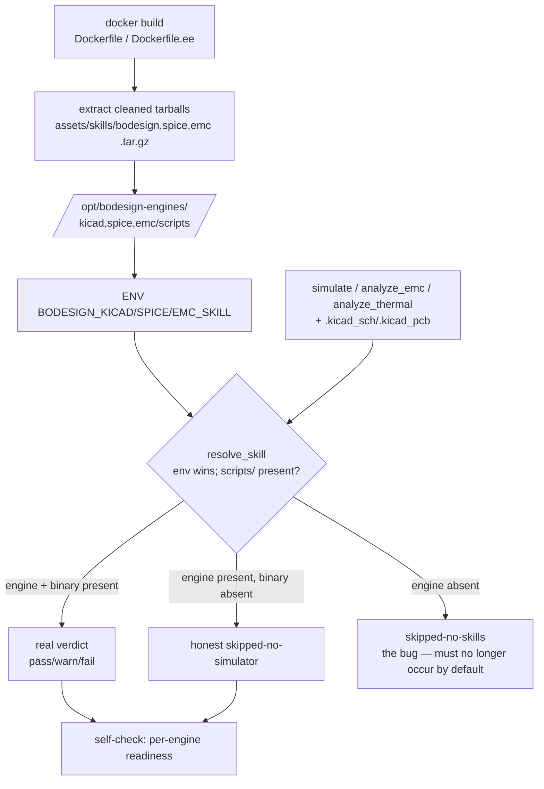

# Design: deployment_c06-analyzer-engines-in-container

## Context

bodesign is a containerized MCP service. Its three C06 verification tools —
`bodesign_simulate`, `bodesign_analyze_emc`, `bodesign_analyze_thermal` — resolve
their analyzer engine at runtime via `resolve_skill(name, BODESIGN_*_SKILL, ...)`,
which qualifies a candidate **only if it contains a `scripts/` subdir**. The Docker
images bundle the binary toolchain (kicad-cli, pcbnew, ngspice) but never the
analyzer engine **scripts**, and set no `BODESIGN_*_SKILL` env. So `resolve_skill`
returns `None` → all three tools return `skipped-no-skills` → C06 SPICE/EMC/thermal
is structurally unable to run. The honesty model forbids fabricated verdicts, so
this leaves C06 permanently stuck at `not-run` with no in-bounds recovery path.

This is the deployment sibling of `quality_readiness-fail-loud-on-invisible-path`:
both touch the "container boundary" theme, but that one is a *path-visibility*
contract bug, this one is *engine scripts never packaged into the image*.

## Architecture

The single chokepoint is the image build: bundle the engine `scripts/` to a fixed,
`$HOME`-independent path and point the three env vars at them. Because env wins in
`resolve_skill`'s resolution order, runtime resolution becomes deterministic and
never depends on `~/.claude`. Applied to the two EE-executing images only.

## Engine availability reality (the actual gap)

| Engine | In repo working tree | As cleaned tarball | In any image today |
|---|---|---|---|
| kicad | `skills/bodesign/engines/kicad/scripts` ✅ | `bodesign.tar.gz` ✅ | ❌ never copied |
| spice | ✗ absent | `spice.tar.gz` ✅ | ❌ |
| emc | `engines/emc` exists but **no `scripts/`** ✗ | `emc.tar.gz` ✅ | ❌ |

So the raw repo `skills/` tree cannot be the source (incomplete + unscrubbed); the
already-cleaned `services/mcp/assets/skills/*.tar.gz` distributables are.

## Goals / Non-Goals

### Goals

- The default deployment can actually run all three C06 tools against a real
  `.kicad_sch` + `.kicad_pcb` and emit a real verdict — never `skipped-no-skills`.
- Engine scripts present in every EE-executing image at a deterministic path,
  resolved without host-dir guessing (env-var precedence).
- Analyzer-engine readiness observable in one call (no `docker exec` probing).
- Docs asserting a default engine path match container reality.

### Non-Goals

- Runtime bind-mounting the user's `~/.claude/skills` (host-dependent, non-portable).
- Refactoring `resolve_skill`'s order (env-var win already suffices).
- Changing the honesty model or the `skipped-no-*` three-state contract.
- New analyzer capabilities — this is packaging/deployment, not analyzer work.

## Decisions

- **DD-1**: Root cause is *packaging*, not *mounts* — images ship the binary
  toolchain but never the analyzer engine scripts `resolve_skill` requires, and
  set no `BODESIGN_*_SKILL` env; the fix lives in the Dockerfiles, not in compose
  `volumes:` and not in `resolve_skill`.
- **DD-2**: Bundle engines by **extracting the cleaned
  `services/mcp/assets/skills/*.tar.gz` distributables** (`bodesign.tar.gz` →
  engines/kicad; `spice.tar.gz`; `emc.tar.gz`), NOT by `COPY`-ing the raw repo
  `skills/` tree, because the raw tree is incomplete (no `spice`, `emc` lacks
  `scripts/`) and unscrubbed. The tarballs are the reviewed single source of truth.
- **DD-3**: Install engines to a fixed `$HOME`-independent path
  (`/opt/bodesign-engines/...`) and set `BODESIGN_KICAD_SKILL` /
  `BODESIGN_SPICE_SKILL` / `BODESIGN_EMC_SKILL` as image ENV pointing at the
  extracted `scripts/`-bearing dirs. Env precedence makes resolution deterministic
  regardless of the runtime user's home.
- **DD-4**: Apply to **both** `Dockerfile` (monolith `--tools all`) and
  `Dockerfile.ee` (`--tools ee`); leave `Dockerfile.core` untouched because the
  lean core forwards the EE group to `bodesign-ee` and executes no EE tool locally
  (verified against `_EE_GROUP_TOOLS` + the core `forward` routing in server.py).
- **DD-5**: Add a deployment self-check reporting, per engine, both
  *engine-resolvable* (`resolve_skill` non-None) and *binary-present*
  (kicad-cli / ngspice on PATH), so "can C06 run here" is one call. Surface via an
  existing diagnostics/health path rather than a new heavyweight tool (exact host
  decided in tasks). Honest `skipped-no-simulator` (binary genuinely absent) stays
  distinct from `skipped-no-skills` (engine script absent — the bug fixed here).
  - **DD-5 host (resolved, implemented 2026-06-23)**: a dedicated no-arg **EE-group**
    MCP tool `bodesign_analyzer_selfcheck` (not an extension of
    `bodesign_vault_diagnostics`), backed by the pure `analyzer_engine_status()`
    helper in `eda-bridge/skill_paths.py`. EE-group so it routes to the process that
    actually runs the analyzers (monolith local, or forwarded to `bodesign-ee`);
    the lean core reports `image_role: core`. Returns per-engine
    `{engine_resolvable, binary, binary_present, resolved_path, can_run}` +
    `image_role` + `all_runnable`.
- **DD-6**: Correct docs asserting a default engine path: `server.py` instruction
  (`BODESIGN_KICAD_SKILL (default ~/.claude/skills/...)`), `MANIFEST.md`,
  `skills/bodesign/SKILL.md`, and enablement — state the real in-container path /
  that the image self-bundles, so agents stop being told a path absent in the
  container. Cross-link the `container-boundary.md` reference added by the
  readiness sibling.
- **DD-7** (added 2026-06-23, completes the engine-runnable promise; ref BR
  `issue_20260623_analyze_emc_synthesis_drops_findings`): the bundled split-dir
  layout (`/opt/bodesign-engines/{emc, bodesign/engines/kicad}`) exposed a
  **cross-engine import** — the emc analyzer's `emc_formulas` imports `kicad_utils`
  from the **kicad** engine, which is not on the emc subprocess's `sys.path`, so
  `analyze_emc.py` crashed with `ModuleNotFoundError` and wrote nothing → surfaced
  as `analyze_emc` "failed: produced no output". The engine *gate* (`resolve_skill`)
  passed; synthesis failed one step later — a gap the initial C06 verification
  missed because it never ran a full emc verdict (only simulate + the emc/thermal
  gate). Fix in `pcb_verify.py`: run the emc subprocess with the kicad engine's
  `scripts/` dir prepended to `PYTHONPATH` (`_engine_env` helper), and surface the
  subprocess stderr in the failure warning (fail-loud-with-cause) instead of a bare
  "produced no output". The integration test's skip-guard also widened to recognize
  the bundled layout (`resolve_skill`) — checking only legacy `~/.claude/skills` is
  what let this slip past CI.

## Risks / Trade-offs

- **R1 — image weight**: engine scripts are markdown+python, negligible vs the
  ~GB toolchain already present. Accept.
- **R2 — tarball ↔ resolve layout drift**: extraction must yield a `scripts/`
  subdir at the env-pointed path or `resolve_skill` still returns None.
  Mitigation: a build-time assert (`test -d $BODESIGN_*_SKILL/scripts`) fails the
  build loudly rather than shipping a silently-broken image.
- **R3 — two images to keep in sync**: monolith + ee can drift. Mitigation: factor
  the extraction+env into a shared Dockerfile snippet / build stage if practical;
  at minimum the self-check (DD-5) catches a missing engine at runtime.
- **R4 — binary present but engine still skips**: covered by DD-5 distinguishing
  engine-resolvable from binary-present, so the failure mode is diagnosable, not
  silent.

## Critical files

- `Dockerfile` — monolith image; add engine extraction + env.
- `Dockerfile.ee` — EE worker image; add engine extraction + env.
- `Dockerfile.core` — confirm NOT touched (forwards EE; no local engine need).
- `services/mcp/assets/skills/{bodesign,spice,emc}.tar.gz` — bundle source.
- `packages/eda-bridge/bodesign_eda_bridge/skill_paths.py` — `resolve_skill` (env precedence).
- `packages/eda-bridge/bodesign_eda_bridge/pcb_verify.py` — analyze_emc/thermal skip path.
- `packages/eda-bridge/bodesign_eda_bridge/simulate.py` — simulate skip path.
- `services/mcp/server.py` — `_EE_GROUP_TOOLS` (proves group) + instruction default-path string (DD-6).
- `services/mcp/assets/skills/MANIFEST.md` — doc alignment (DD-6).
- `skills/bodesign/SKILL.md` + `references/container-boundary.md` — doc alignment (DD-6).
- self-check host (diagnostics/health path) — DD-5.

## Code anchors

- skill_paths.py:31 — `resolve_skill` resolution order (env-var precedence the fix relies on).
- pcb_verify.py:55-58,84-86 — analyze_emc / analyze_thermal skip-on-missing.
- simulate.py:48-52 — simulate skip-on-missing.
- server.py:39 — instruction default-path string to correct.
- server.py `_EE_GROUP_TOOLS` / `_group_of` — proves the three tools are EE-group.

## Verification strategy

- Build both images; assert each of the three env vars resolves to a dir with a
  `scripts/` subdir and `resolve_skill` returns non-None for kicad/spice/emc.
- Run the three tools against the BR fixture (`aiguard_power.kicad_sch` +
  `aiguard_power_routed.kicad_pcb`) and assert no result is `skipped-no-skills`.
- Self-check reports engine+binary ready for kicad/spice/emc in the EE image.
- Negative: the `Dockerfile.core` image still forwards EE and is unaffected.
