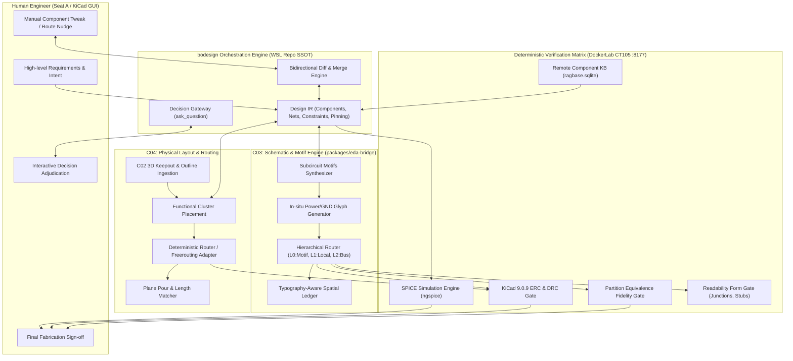

# Proposal: eda-bridge_human-ai-collaborative-system

_語言：[zh-hant](./) · **en**_

> Auto-generated index for the `eda-bridge_human-ai-collaborative-system` topic. Edit the source files; this README mirrors them. Do not edit this file directly.

## Status

**Implementing** · 5 history entries · last advance 2026-10-05 (mode `promote` from planned)

## Source artifacts

- [`proposal.md`](./proposal.md) — why this exists · modified 2026-10-05
- [`design.md`](./design.md) — architecture & decisions · modified 2026-10-05
- [`tasks.md`](./tasks.md) — checklist · 0/17 done (0%) · modified 2026-10-05
- `.state.json` — lifecycle state machine

## Why (excerpt)

In commercial circuit board development, black-box fully automated generative tools fail to gain engineer trust because they lack deterministic validation, visual readability, and fine-grained control. Simultaneously, the current `bodesign` schematic drawing pipeline suffers from severe architectural defects:
1. **Inability to draw real schematics ("畫不出來")**: Under `draftsman` mode with real multi-component circuits (e.g. `04.btdongle`), 74% of wires degenerate into 5.08mm pin-to-label stubs, zero junctions are formed, and passive components (R/C/L) hang with single unconnected pins attached to labels.
2. **Collinear fusion & Hard crashes**: For basic series dividers (`U1 -> R1 -> R2 -> GND`), vertical stacking in force-directed placement creates collinear wire overlaps that fuse `VOUT` into `GND`, triggering `FidelityError` exceptions that abort schematic composition entirely.
3. **Surrender anti-fusion guard**: When Manhattan orthogonal routes cannot clear obstacles after 3 small jogs, the engine's default policy is to abandon wire routing entirely and downgrade the entire net to per-pin label stubs.
4. **Lack of subcircuit motif primitives**: The placement engine treats every component (from a 64-pin MCU to an 0402 100nF capacitor) as an undifferentiated graph node in Fruchterman-Reingold force-directed placement. Passives are scattered radially, decoupling capacitors fly away from power pins, and voltage dividers fail to align.
5. **Global bus routing of power/ground nets**: Global power rails (especially `GND` with 50+ nodes) are daisy-chained across the entire sheet in 1200mm snake routes sorted by (x, y) ascending coordinates, causing massive route blockages and wire collisions.
6. **Lack of human-in-the-loop collaborative primitives**: Engineers cannot easily tweak intermediate AI-generated designs in KiCad GUI without having their changes overwritten upon the next AI iteration.

This plan establishes a comprehensive overhaul: transitioning `bodesign` into a **Mixed-Initiative Human-AI Collaborative PCB Co-Design System**, anchoring on **Subcircuit Motifs**, **In-situ Power/GND Glyphs**, **Bidirectional KiCad Sync with User-Pinning**, and **Deterministic Multi-Tier Verification**.

[Full →](./proposal.md)

## Architecture overview

[Full design →](./design.md)

## Recent activity

- 2026-10-05: `promote` planned → implementing — Plan approved by user; beginning implementation of Phase 1 and remediation of core defects
- 2026-10-05: `promote` designed → planned — Tasks.md carries complete 5-phase work breakdown with measurable acceptance criteria and 4 concrete test vectors
- 2026-10-05: `promote` proposed → designed — Proposal, spec, design with Mermaid architecture and required headings, tasks, errors codomain authored
- 2026-10-05: `sync` proposed → proposed — Set profile to docs for architectural design and specification package
- 2026-10-05: `new` (initial) → proposed — initial spec created via plan-init.ts (profile=software)

<!-- AUTO-GENERATED by plan-builder MCP plan_sync · 2026-10-05T11:50:27Z · do not edit this file. -->
