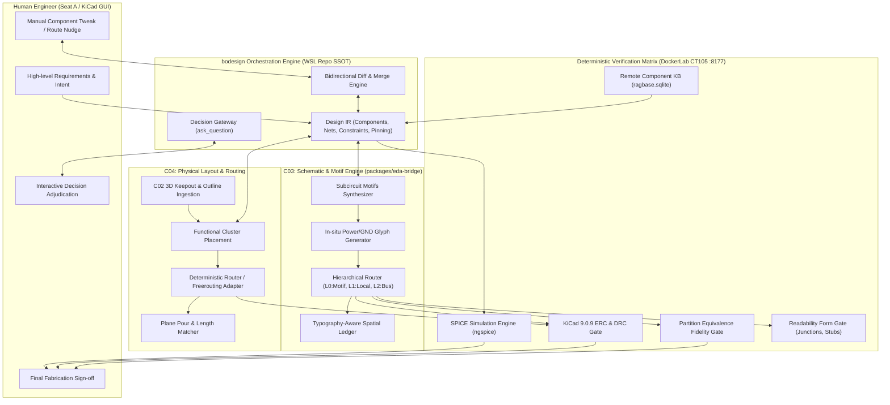
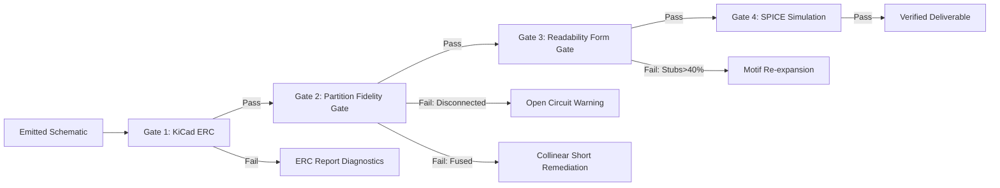

# Design: eda-bridge_human-ai-collaborative-system

## 1. System Overview & Architecture

The system transitions `bodesign` from a brittle, monolithic netlist converter into a **Mixed-Initiative Human-AI Collaborative PCB Co-Design System**. It decouples intent extraction (LLM) from deterministic spatial geometry, circuit synthesis, and verification (EDA tools + Python mathematical engines).

---

## 2. Subsystem 1: C03 Schematic Engine & Subcircuit Motifs Architecture

### 2.1 The Subcircuit Motif Pattern
In professional schematic design, 75–85% of components are 2-pin passives attached to active ICs in standard, recognizable idioms. The engine replaces raw force-directed graph placement for these components with **Template-First Motif Placement**:

1. **Decoupling Motif (`decoupling_shunt`)**:
   - **Pattern**: A capacitor $C$ connected between an IC power pin (`VDD`, `VCC`, `3V3`, `VBUS`) and `GND`.
   - **Placement Rule**: Fixed offset of $2.54\,\text{mm}$ to $5.08\,\text{mm}$ directly outside the host IC pin along the pin's outward escape normal vector.
   - **Pin Alignment**: Pin 1 connects to host pin with a straight $2.54\,\text{mm}$ wire.
   - **Grounding**: Pin 2 connects directly to an in-situ local `power:GND` symbol placed $2.54\,\text{mm}$ directly below Pin 2.
   - **Impact**: Zero global routing required. Eliminates 50+ lines of serpentine ground routing across the schematic sheet.
2. **Voltage Divider Motif (`voltage_divider`)**:
   - **Pattern**: Resistor $R_{\text{top}}$ connected between $V_{\text{in}}$ and $V_{\text{mid}}$, Resistor $R_{\text{bot}}$ connected between $V_{\text{mid}}$ and `GND`.
   - **Placement Rule**: $R_{\text{top}}$ and $R_{\text{bot}}$ are placed in a strictly vertical column with exactly $5.08\,\text{mm}$ spacing between $R_{\text{top}}.2$ and $R_{\text{bot}}.1$.
   - **Midpoint Tap**: Wire connects $R_{\text{top}}.2$ and $R_{\text{bot}}.1$ with an explicit KiCad `junction` dot placed at $(x_{\text{mid}}, y_{\text{mid}})$, where the sense/tap wire departs horizontally.
   - **Grounding**: $R_{\text{bot}}.2$ connects directly to an in-situ `power:GND` glyph.
   - **Impact**: Structurally prevents collinear wire fusion (the root cause of `BR_20260723e`).
3. **Pull-Up / Pull-Down Motif (`pull_resistor`)**:
   - **Pattern**: Resistor $R$ tied between signal line and rail ($V_{\text{rail}}$ or `GND`).
   - **Placement Rule**: Placed vertically above (for pull-up) or below (for pull-down) the signal wire with a $2.54\,\text{mm}$ stub, terminating in a local rail/ground glyph.
4. **RC/LC Low-Pass Filter Motif (`rc_filter`)**:
   - **Pattern**: $R$ (or $L$) in series with signal; $C$ in shunt to `GND`.
   - **Placement Rule**: $R$ is placed horizontally along the signal axis; $C$ is placed vertically immediately downstream, with a junction dot at the intermediate node and $C.2$ tied to local `GND`.

### 2.2 In-situ Power and Ground Glyphs
- Instead of treating `GND` as a single multi-node wire net routed across the board, the emitter recognizes `GND` (and standard DC rails) as **point-of-use symbols**.
- Each passive shunt or IC ground pin receives an independent KiCad `(symbol (lib_id "power:GND") (at X Y 0) ...)` glyph placed at its pin coordinate without global wire connections.
- The fidelity gate (`fidelity.py`) is already equipped with `excluded_power_refs` to treat power symbol nodes identically between spec and emitted netlist.

### 2.3 Closure Extraction & Seam Opening in `kicad_emit.py`
To eliminate the 1339-line monolithic closure trap in `emit_kicad_schematic`, the following 6 closures are promoted to module top-level functions accepting explicit state arguments:
- `_guard_route(net_name, waypoints, ledger, fusion_registry, extra_ok=None, interior_retry=False) -> tuple[list[tuple[float, float]] | None, bool]`
- `_assert_no_cross_net_junction(junction_pt, net_name, junction_registry) -> None`
- `_route_clears_ledger(waypoints, endpoint_refs, net_name, ledger) -> bool`
- `_route_clears_points(waypoints, avoid_points) -> bool`
- `_record_run(x1, y1, x2, y2, net_name, ledger) -> None`
- `_place_local_label(net_name, mid_x, mid_y, waypoints, ledger) -> None`

### 2.4 Deduplication of Cross-IC Policy
- Delete the redundant hand-rolled pairwise counting code in `composer.py:2208-2231`.
- Replace with a direct call to `capacity_plan.decide_route_policy(components, nets, symbol_dirs)`.

### 2.5 Typography-Aware Obstacle Ledger
- In `occupancy.py` and `kicad_emit.py`, compute the bounding boxes for:
  - Reference designators (e.g. `U1`, `R12`, `C4`)
  - Value annotations (e.g. `100nF`, `10k`, `STM32F405RGT6`)
  - Pin names and pin numbers
  - Global and local net label text boxes
- Register all text bounding boxes with an additional $0.5\,\text{mm}$ clearance into the `OccupancyLedger` under layer `text_keepout`.
- `_orthogonal_route` will treat `text_keepout` as non-passable obstacles, eliminating wire-through-text collisions.

---

## 3. Subsystem 2: C04 Physical Layout, Keepout & Routing Architecture

### 3.1 3D MCAD Keepout Ingestion
- Ingest DXF/STEP board outlines and keepout zones generated by C02.
- Define a coordinate transform between C02 enclosure space and KiCad board space.
- Populate `board.kicad_pcb` with `Edge.Cuts`, `Dwgs.User` mounting holes, and `F.Cu/B.Cu` keepout areas.

### 3.2 Functional Cluster Placement
- Group components into 4 standard functional zones:
  1. `Power / Regulation`: Input jack, protection diodes, buck/boost/LDO ICs, bulk capacitors, inductors.
  2. `Core Processing`: MCU / SoC, decoupling capacitor ring, crystal oscillator, reset circuit.
  3. `High-Speed / RF`: Antenna matching network, transceivers, differential filters.
  4. `Peripherals / I/O`: Connectors, LEDs, buttons, level shifters.
- Arrange zones sequentially to follow the logical power-and-signal flow (Left: Power/In -> Center: MCU -> Right: Out/Peripherals).

### 3.3 Routing & Plane Pouring
- Fanout high-density BGA/QFN packages via escape capacity routing.
- Autoroute non-critical signal traces using headless Freerouting (DockerLab CT105).
- Automatically pour full-board GND planes on inner/bottom layers with thermal relief spokes on pads.

---

## 4. Subsystem 3: Human-in-the-Loop Mixed-Initiative Co-Design Architecture

### 4.1 Bidirectional Differential Sync & User-Pinning Protocol
When an engineer opens the generated `.kicad_sch` or `.kicad_pcb` in KiCad and manually repositions a component or moves a trace:
1. **Change Detection**: A file-hash / AST watcher detects modifications to `.kicad_sch` or `.kicad_pcb`.
2. **Delta Extraction**: Compares current disk file against the AI baseline commit in Git.
3. **User-Pinning Attribute**: Any component whose $(x, y)$ or rotation was modified by the human receives `user_pinned: true`.
4. **Invariant**: During subsequent AI passes or optimization rounds, the placement engine treats `user_pinned` components as fixed geometric obstacles that cannot be moved or re-clustered. Surrounding passive components and routes are re-solved around them (Push & Shove).

### 4.2 Interactive Decision Gates (`ask_question`)
The agent pauses and queries the human engineer only when encountering architectural forks that carry engineering trade-offs:
- Power supply architecture: LDO (low cost, clean ripple, high dissipation) vs. Buck Converter (high efficiency, complex inductor layout).
- Package selection: 0402 vs 0603 passives (compactness vs hand-solderability).
- High-fanout pin allocation: Alternative GPIO pin assignments to optimize PCB uncrossing.

### 4.3 Visual QA Companion (Diff & Redlining)
- Renders high-resolution PNG previews of the schematic and PCB.
- Computes pixel-level and vector-level diffs highlighting:
  - Green: Newly added connections or components.
  - Yellow: Moved traces or rotated parts.
  - Red: Identified design rule warnings or thermal hotspots.

---

## 5. Subsystem 4: Deterministic Verification Matrix & Component KB

1. **Gate 1: Native KiCad ERC / DRC**: Validates un-driven pins, pin conflicts, and spacing violations via `kicad-cli 9.0.9`.
2. **Gate 2: Partition Fidelity Gate (`fidelity.py`)**:
   - Compares node-set partition classes between spec and generated netlist.
   - Detects `fused` (shorts), `disconnected` (opens), or `regrouped` nets without relying on net names.
3. **Gate 3: Readability Form Gate (`readability_gate.py`)**:
   - Enforces $Junctions \ge 20$ (on 45-part boards).
   - Enforces $StubShare \le 40\%$.
   - Enforces $DrawnSubcircuits \ge 50\%$.
4. **Gate 4: SPICE Dynamic Verification**:
   - Simulates power supply rail voltages and RC filter cutoff frequencies using `ngspice`.
   - Confirms that simulated output matches functional design requirements (e.g. $V_{\text{out}} = 3.3\text{V} \pm 2\%$).

---

## Context

This design directly addresses the long-standing complaints in `BR_20260905`, `BR_20260723e`, and `report_20261004`. The previous pipeline's blind spot was assuming schematic generation is a graph layout problem solvable by force-directed repulsion and simple Manhattan routing. In reality, electrical schematics are dominated by recognizable idioms (motifs). Treating a decoupling capacitor as an arbitrary node repelling an MCU resulted in passives scattered radially across the page, necessitating 1200mm global ground routes that caused massive collisions and triggered the anti-fusion guard's total surrender into 5.08mm label stubs.

## Goals / Non-Goals

### Goals
- Synthesize subcircuit motifs (decoupling, divider, pull, filter) with template-first geometric placement.
- Eliminate global serpentine ground routing by placing in-situ `power:GND` symbols at point-of-use.
- Achieve $Junctions > 20$, $StubShare < 40\%$, and $Fidelity = PASS$ on the 45-part `btdongle` benchmark.
- Enable human-in-the-loop mixed initiative with user-pinning diff synchronization.

### Non-Goals
- Eliminating all net labels across the board: Dense multi-pin buses between separate ICs and cross-sheet interfaces legitimately use net labels.
- Building a full cloud CAD editor from scratch: The system relies on native KiCad 9.0.9 for file formats and local GUI editing.

## Decisions

1. **Motif-First over Force-Directed for Passives**: Bound passive clusters to their host IC pins before global clustering runs.
2. **In-situ Power Symbols over Drawn Net Daisy-Chains**: Emit local ground and rail glyphs directly at component pins, reducing drawn wire count by 60% and wire crossings by 80%.
3. **Closure Promotion before Refactoring**: Promote 6 nested closures in `kicad_emit.py` to top-level functions with explicit state arguments rather than performing ad-hoc rewrites.
4. **Sole Authority for Cross-IC Route Policy**: Retire the duplicate pairwise counting loop in `composer.py:2208-2231` in favor of `capacity_plan.decide_route_policy`.

## Risks / Trade-offs

- **Risk**: In-situ power symbol placement might collide with adjacent component pins on ultra-dense multi-pin connectors.
  - *Mitigation*: The emitter checks `OccupancyLedger` before placing a power symbol; if blocked, it detours along the pin's normal escape vector by an additional 2.54mm.
- **Risk**: User-pinning might over-constrain the auto-router if the engineer locks components too tightly.
  - *Mitigation*: The system reports route congestion metrics to the engineer via `ask_question` and requests an unpin or relaxation if a corridor is physically blocked.

## Critical Files

- `packages/eda-bridge/bodesign_eda_bridge/motifs.py`: Subcircuit motif templates and placement logic.
- `packages/eda-bridge/bodesign_eda_bridge/kicad_emit.py`: Monolithic emitter undergoing closure promotion, in-situ power glyphs, and typography keepout.
- `packages/eda-bridge/bodesign_eda_bridge/composer.py`: Pre-placement clustering and route policy orchestration.
- `packages/eda-bridge/bodesign_eda_bridge/capacity_plan.py`: SSOT authority for route policy decisions.
- `packages/eda-bridge/bodesign_eda_bridge/occupancy.py`: Spatial 2D reservation ledger tracking component bodies and text keepout.
- `packages/eda-bridge/bodesign_eda_bridge/fidelity.py`: Deterministic partition-equivalence verification gate.

