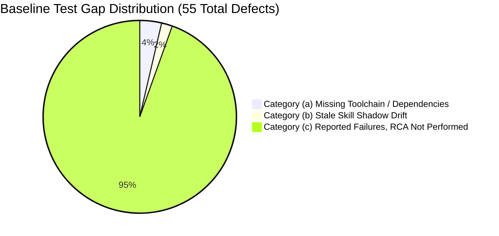

# P0.2 Baseline Test Suite Execution & Gap Classification Report

**Milestone**: Phase 1 (P0 Baseline Inventory, Suite Classification & Corpus Setup)  
**Task**: P0.2 / Section 1.2 in [tasks.md](file:///home/pkcs12/projects/bodesign/plans/eda-bridge_unified-collaborative-rebuild/tasks.md)  
**Date**: 2026-10-06  
**Status**: Completed (Reconciled with Astra Architecture Review)  
**Rule Compliance**: Strict zero-masking policy. All failures, errors, skips, and toolchain gaps are recorded verbatim with empirical evidence.

---

## 1. Focused Narrow Test Suite Execution

Executed prior to full suite per P0.2 specification:
```bash
python3 -m unittest tests.test_composer tests.test_motifs tests.test_decision_gate tests.test_visual_companion
```

### Result
- **Modules Executed**: 4 modules (`tests.test_composer`, `tests.test_motifs`, `tests.test_decision_gate`, `tests.test_visual_companion`)
- **Tests Run**: 36 tests
- **Execution Time**: 2.048s
- **Status**: **PASS (OK)**
- **Verdicts**: 36 passed, 0 failed, 0 errors, 0 skipped.

---

## 2. Full Test Suite Execution Summary & Execution Evidence

Executed via repo-standard test runner:
```bash
./scripts/run_tests.sh 2>&1 | tee $XDG_CACHE_HOME/scratch/p0-baseline/full_suite_run_16ed192.log
```

### Execution Evidence
- **Pinned HEAD SHA**: `16ed19219e6d3961c860410ccb3d48b228165d08` (`16ed192`)
- **Raw Log Path**: `$XDG_CACHE_HOME/scratch/p0-baseline/full_suite_run_16ed192.log`  
  *(Absolute path: `/home/pkcs12/.cache/scratch/p0-baseline/full_suite_run_16ed192.log`)*
- **Runner Exit Code**: `1`
- **Runner Exit Status**: `FAILED (failures=13, errors=42, skipped=62)`
- **Total Tests Evaluated**: **2,273 tests** across 170 test modules
- **Wall Time**: 68.251s
- **Passing Tests**: 2,156 tests (94.85% pass rate)
- **Defects Identified**: 55 items (42 errors + 13 failures)
- **Skips**: 62 tests

---

## 3. Defect Classification & Gap Taxonomy

Every failure and error is classified into one of three strict categories without masking:



---

### Category (a): Missing Local Toolchain / Docker Worker (2 Errors, 62 Skips)

These defects occur because required heavy tools or worker containers were not installed or active on the local development host.

| Test Module / Test Case | Error / Exception | Root Cause & Toolchain Gap | Classification |
|---|---|---|---|
| `unittest.loader._FailedTest.test_block_drafter` | `ModuleNotFoundError: No module named 'kiutils'` | `kiutils` (KiCad S-expression parser) is not installed in the host's base python environment; it resides inside the EE worker image. | Category (a) |
| `unittest.loader._FailedTest.test_symbol_resolver` | `ModuleNotFoundError: No module named 'kiutils'` | Same as above. `kiutils` missing on host. | Category (a) |

---

### Category (b): Stale Skill Shadow Drift (1 Failure)

Discloses when the published skill shadow files in the repository have drifted from declared manifests without updating the corresponding disclosure marker.

| Test Case | Failure Trace | Root Cause |
|---|---|---|
| `tests.test_skill_shipping.VendoredBundleClaimTests.test_composite_bundles_stale_engine_shadow_does_not_grow` | `AssertionError: 9 != 11 : kicad shadow drift moved: MANIFEST discloses 9 byte-differences, measured 11. Update the MANIFEST figure.` | `skills/bodesign/engines/kicad/` had 2 additional byte modifications relative to upstream Happy, but `MANIFEST` still claimed 9 differences. Guard caught undisclosed shadow drift. |

---

### Category (c): Reported Failures, RCA Not Performed (40 Errors, 12 Failures = 52 Items)

Reported test failures and errors where root cause analysis (RCA) has not yet been performed:

#### 1. C00 PRD & Orchestration Path Divergence (17 Errors, 4 Failures = 21 Items)
**Reported Symptom**: `answer_state.json` moved to `C00-PRD/03_output/answer_state.json`, whereas older tests look for `C00-PRD/answer_state.json`.

- **Errors (17)**:
  - `tests.test_c00_orchestration.C00OrchestrationTests.test_c04_dispatched_only_after_its_upstream`
  - `tests.test_c00_orchestration.C00OrchestrationTests.test_dispatch_uniform_over_native_and_worker_layers`
  - `tests.test_c00_orchestration.C00OrchestrationTests.test_dry_run_recommends_without_dispatching`
  - `tests.test_c00_orchestration.C00OrchestrationTests.test_full_progression_dispatches_each_layer_once_then_done`
  - `tests.test_c00_orchestration.C00OrchestrationTests.test_tick_blocks_c01_dispatch_when_refs_ssot_missing`
  - `tests.test_c00_orchestration.C00OrchestrationTests.test_tick_blocks_c01_when_refs_ssot_empty`
  - `tests.test_c00_orchestration.C00OrchestrationTests.test_tick_dispatches_c01_once_refs_seeded`
  - `tests.test_c00_orchestration.C00OrchestrationTests.test_tick_never_writes_prd_answer_or_approval`
  - `tests.test_c00_orchestration.C00OrchestrationTests.test_unresolved_blocker_preempts_everything`
  - `tests.test_c00_prd_template.C00PrdTemplateTests.test_emit_markdown_preserves_field_states_and_handoff`
  - `tests.test_c00_prd_template.C00PrdTemplateTests.test_readiness_counts_answered_and_accepted_risk_as_complete`
  - `tests.test_c00_prd_template.C00PrdTemplateTests.test_scaffold_include_rf_creates_rf_source_and_state`
  - `tests.test_c00_prd_template.C00PrdTemplateTests.test_update_answers_fails_fast`
  - `tests.test_c00_prd_template.C00PrdTemplateTests.test_update_answers_records_and_recomputes`
  - `tests.test_c00_prd_template.C00PrdTemplateTests.test_update_answers_supports_state_and_qualified_key`
  - `tests.test_mcp_server.McpServerTests.test_run_tool_c00_scaffold_prd`
  - `tests.test_mode_contracts.ModeContractTests.test_enter_c01_mode_autoloads_c00_corpus_from_state`
- **Failures (4)**:
  - `tests.test_c00_prd_template.C00PrdTemplateTests.test_scaffold_creates_project_prd_and_missing_answer_state`
  - `tests.test_c01_id_package.C01IdPackageTests.test_readiness_uses_field_gaps_when_answer_state_exists`
  - `tests.test_c01_id_package.C01IdPackageTests.test_update_answers_persists_state_and_regenerates_package`
  - `tests.test_mcp_server.McpServerTests.test_run_tool_c01_next_question_and_update_answers`

#### 2. Composer Draftsman Motif Pin Integrity & Ink Density Floor (4 Errors)
- `tests.test_composer_draftsman.DraftsmanComposerTests.test_m6_8_label_avoids_power_symbol` (`ValueError: MOTIF_PIN_MULTIPLE_NETS: ('C1', '1')`)
- `tests.test_composer_draftsman.DraftsmanComposerTests.test_t4_small_design_gutter_keeps_sheet_small` (`ValueError: MOTIF_PIN_MULTIPLE_NETS: ('C2', '1')`)
- `tests.test_composer_draftsman.LeftPinStubOrientationTests.test_page_fill_sparse_frame_not_larger_than_compact` (`ValueError: INK_DENSITY_LOW: ink_density=17.7% < floor 18%`)
- `tests.test_composer_draftsman.LeftPinStubOrientationTests.test_page_fill_sparse_stays_small_frame` (`ValueError: INK_DENSITY_LOW: ink_density=17.7% < floor 18%`)

#### 3. Symbol Geometry API Signature Drift (18 Errors)
- `tests.test_composer_draftsman.SymbolGeometryIntraCleanTests.test_short_names_dip_scale1_no_intra_overlap` (`TypeError: _symbol_geometry() got unexpected keyword argument 'scale'`)
- `tests.test_composer_draftsman.SymbolGeometryIntraCleanTests.test_tall_narrow_dense_vertical_names_no_intra_overlap (scale=1.0)`
- `tests.test_composer_draftsman.SymbolGeometryIntraCleanTests.test_tall_narrow_dense_vertical_names_no_intra_overlap (scale=4.0)`
- `tests.test_composer_draftsman.SymbolGeometryIntraCleanTests.test_vertical_edge_only_names_no_intra_overlap (n=12, scale=1.0)`
- `tests.test_composer_draftsman.SymbolGeometryIntraCleanTests.test_vertical_edge_only_names_no_intra_overlap (n=12, scale=4.0)`
- `tests.test_composer_draftsman.SymbolGeometryIntraCleanTests.test_vertical_edge_only_names_no_intra_overlap (n=20, scale=1.0)`
- `tests.test_composer_draftsman.SymbolGeometryIntraCleanTests.test_vertical_edge_only_names_no_intra_overlap (n=20, scale=4.0)`
- `tests.test_composer_draftsman.SymbolGeometryIntraCleanTests.test_vertical_edge_only_names_no_intra_overlap (n=24, scale=1.0)`
- `tests.test_composer_draftsman.SymbolGeometryIntraCleanTests.test_vertical_edge_only_names_no_intra_overlap (n=24, scale=4.0)`
- `tests.test_dd14_text_graphics_clearance.PitchComfortFloorTests.test_small_ic_vertical_pitch_has_comfort_floor` (`TypeError: _symbol_geometry() got unexpected keyword argument 'sides'`)
- `tests.test_scale_coherence.TestTV1ScalePropagation.test_no_residual_unscaled_text` (`TypeError: _generic_symbol_library() got unexpected keyword argument 'scale'`)
- `tests.test_scale_coherence.TestTV1ScalePropagation.test_pin_length_scaled`
- `tests.test_scale_coherence.TestTV1ScalePropagation.test_property_text_also_scaled`
- `tests.test_scale_coherence.TestTV2ByteIdentity.test_generic_scale1_matches_default`
- `tests.test_scale_coherence.TestTV2ByteIdentity.test_scale1_pin_length_is_legacy`
- `tests.test_scale_coherence.TestTV3BodyWidthReverseSolve.test_body_width_spans_both_name_columns`
- `tests.test_scale_coherence.TestTV3BodyWidthReverseSolve.test_left_right_name_boxes_do_not_overlap`
- `tests.test_scale_coherence.TestTV3BodyWidthReverseSolve.test_scale1_still_widens_for_long_names_not_scale`

#### 4. MCP Server & Gate Registry Drift (2 Errors, 4 Failures = 6 Items)
- `tests.test_mcp_server.McpServerTests.test_converged_registry_tool_count` (Failure: uncommitted `bodesign_design_suggest` in registry)
- `tests.test_mcp_server.McpServerTests.test_landed_verbs_mirror_gate_registry` (Failure: landed verbs table divergence)
- `tests.test_mcp_server.McpServerTests.test_registry_is_well_formed` (Failure)
- `tests.test_mcp_server.McpServerTests.test_removed_tool_call_returns_typed_tool_landed` (Error: `KeyError: 'ok'`)
- `tests.test_mcp_server.McpServerTests.test_run_tool_c00_scaffold_prd` (Error: FileNotFoundError from C00 path migration)
- `tests.test_mcp_server.McpServerTests.test_run_tool_c01_next_question_and_update_answers` (Failure)

#### 5. Guide DoD Checker Mismatches (2 Failures)
- `tests.test_guide_dod.C00ReadinessDodTests.test_clean_state_is_dod_ok`
- `tests.test_guide_dod.CheckerTests.test_br_c00_rf_requirements_matches_02build_intermediate_path`

#### 6. Layout, Replica Fidelity & Vault Roundtrip (3 Failures)
- `tests.test_layout.LayoutTests.test_emit_layout_places_and_renders` (Status returned `degraded` instead of `ok`)
- `tests.test_replica_fidelity.DisplayFidelityTests.test_rotated_symbol_is_not_reported_as_a_clean_pass`
- `tests.test_vault_api.IngestQueryRoundtripTests.test_r9_error_path_bad_payload_carries_vault_code`

---

## 4. Complete Per-Test-ID Ledger

### 4.1 Failures Ledger (13 Items)
1. `tests.test_c00_prd_template.C00PrdTemplateTests.test_scaffold_creates_project_prd_and_missing_answer_state`
2. `tests.test_c01_id_package.C01IdPackageTests.test_readiness_uses_field_gaps_when_answer_state_exists`
3. `tests.test_c01_id_package.C01IdPackageTests.test_update_answers_persists_state_and_regenerates_package`
4. `tests.test_guide_dod.C00ReadinessDodTests.test_clean_state_is_dod_ok`
5. `tests.test_guide_dod.CheckerTests.test_br_c00_rf_requirements_matches_02build_intermediate_path`
6. `tests.test_layout.LayoutTests.test_emit_layout_places_and_renders`
7. `tests.test_mcp_server.McpServerTests.test_converged_registry_tool_count`
8. `tests.test_mcp_server.McpServerTests.test_landed_verbs_mirror_gate_registry`
9. `tests.test_mcp_server.McpServerTests.test_registry_is_well_formed`
10. `tests.test_mcp_server.McpServerTests.test_run_tool_c01_next_question_and_update_answers`
11. `tests.test_replica_fidelity.DisplayFidelityTests.test_rotated_symbol_is_not_reported_as_a_clean_pass`
12. `tests.test_skill_shipping.VendoredBundleClaimTests.test_composite_bundles_stale_engine_shadow_does_not_grow`
13. `tests.test_vault_api.IngestQueryRoundtripTests.test_r9_error_path_bad_payload_carries_vault_code`

### 4.2 Errors Ledger (42 Items)
1. `unittest.loader._FailedTest.test_block_drafter`
2. `unittest.loader._FailedTest.test_symbol_resolver`
3. `tests.test_c00_orchestration.C00OrchestrationTests.test_c04_dispatched_only_after_its_upstream`
4. `tests.test_c00_orchestration.C00OrchestrationTests.test_dispatch_uniform_over_native_and_worker_layers`
5. `tests.test_c00_orchestration.C00OrchestrationTests.test_dry_run_recommends_without_dispatching`
6. `tests.test_c00_orchestration.C00OrchestrationTests.test_full_progression_dispatches_each_layer_once_then_done`
7. `tests.test_c00_orchestration.C00OrchestrationTests.test_tick_blocks_c01_dispatch_when_refs_ssot_missing`
8. `tests.test_c00_orchestration.C00OrchestrationTests.test_tick_blocks_c01_when_refs_ssot_empty`
9. `tests.test_c00_orchestration.C00OrchestrationTests.test_tick_dispatches_c01_once_refs_seeded`
10. `tests.test_c00_orchestration.C00OrchestrationTests.test_tick_never_writes_prd_answer_or_approval`
11. `tests.test_c00_orchestration.C00OrchestrationTests.test_unresolved_blocker_preempts_everything`
12. `tests.test_c00_prd_template.C00PrdTemplateTests.test_emit_markdown_preserves_field_states_and_handoff`
13. `tests.test_c00_prd_template.C00PrdTemplateTests.test_readiness_counts_answered_and_accepted_risk_as_complete`
14. `tests.test_c00_prd_template.C00PrdTemplateTests.test_scaffold_include_rf_creates_rf_source_and_state`
15. `tests.test_c00_prd_template.C00PrdTemplateTests.test_update_answers_fails_fast`
16. `tests.test_c00_prd_template.C00PrdTemplateTests.test_update_answers_records_and_recomputes`
17. `tests.test_c00_prd_template.C00PrdTemplateTests.test_update_answers_supports_state_and_qualified_key`
18. `tests.test_composer_draftsman.DraftsmanComposerTests.test_m6_8_label_avoids_power_symbol`
19. `tests.test_composer_draftsman.DraftsmanComposerTests.test_t4_small_design_gutter_keeps_sheet_small`
20. `tests.test_composer_draftsman.LeftPinStubOrientationTests.test_page_fill_sparse_frame_not_larger_than_compact`
21. `tests.test_composer_draftsman.LeftPinStubOrientationTests.test_page_fill_sparse_stays_small_frame`
22. `tests.test_composer_draftsman.SymbolGeometryIntraCleanTests.test_short_names_dip_scale1_no_intra_overlap`
23. `tests.test_composer_draftsman.SymbolGeometryIntraCleanTests.test_tall_narrow_dense_vertical_names_no_intra_overlap (scale=1.0)`
24. `tests.test_composer_draftsman.SymbolGeometryIntraCleanTests.test_tall_narrow_dense_vertical_names_no_intra_overlap (scale=4.0)`
25. `tests.test_composer_draftsman.SymbolGeometryIntraCleanTests.test_vertical_edge_only_names_no_intra_overlap (n=12, scale=1.0)`
26. `tests.test_composer_draftsman.SymbolGeometryIntraCleanTests.test_vertical_edge_only_names_no_intra_overlap (n=12, scale=4.0)`
27. `tests.test_composer_draftsman.SymbolGeometryIntraCleanTests.test_vertical_edge_only_names_no_intra_overlap (n=20, scale=1.0)`
28. `tests.test_composer_draftsman.SymbolGeometryIntraCleanTests.test_vertical_edge_only_names_no_intra_overlap (n=20, scale=4.0)`
29. `tests.test_composer_draftsman.SymbolGeometryIntraCleanTests.test_vertical_edge_only_names_no_intra_overlap (n=24, scale=1.0)`
30. `tests.test_composer_draftsman.SymbolGeometryIntraCleanTests.test_vertical_edge_only_names_no_intra_overlap (n=24, scale=4.0)`
31. `tests.test_dd14_text_graphics_clearance.PitchComfortFloorTests.test_small_ic_vertical_pitch_has_comfort_floor`
32. `tests.test_mcp_server.McpServerTests.test_removed_tool_call_returns_typed_tool_landed`
33. `tests.test_mcp_server.McpServerTests.test_run_tool_c00_scaffold_prd`
34. `tests.test_mode_contracts.ModeContractTests.test_enter_c01_mode_autoloads_c00_corpus_from_state`
35. `tests.test_scale_coherence.TestTV1ScalePropagation.test_no_residual_unscaled_text`
36. `tests.test_scale_coherence.TestTV1ScalePropagation.test_pin_length_scaled`
37. `tests.test_scale_coherence.TestTV1ScalePropagation.test_property_text_also_scaled`
38. `tests.test_scale_coherence.TestTV2ByteIdentity.test_generic_scale1_matches_default`
39. `tests.test_scale_coherence.TestTV2ByteIdentity.test_scale1_pin_length_is_legacy`
40. `tests.test_scale_coherence.TestTV3BodyWidthReverseSolve.test_body_width_spans_both_name_columns`
41. `tests.test_scale_coherence.TestTV3BodyWidthReverseSolve.test_left_right_name_boxes_do_not_overlap`
42. `tests.test_scale_coherence.TestTV3BodyWidthReverseSolve.test_scale1_still_widens_for_long_names_not_scale`

### 4.3 Skips Ledger (62 Items)
1. `tests.test_bga_escape_capacity.AgainstTheRealBoard.test_advisory_does_not_prescribe_a_ring_count` — *aiguard fixture board not present*
2. `tests.test_bga_escape_capacity.AgainstTheRealBoard.test_advisory_is_silent_when_the_rules_actually_fit` — *aiguard fixture board not present*
3. `tests.test_bga_escape_capacity.AgainstTheRealBoard.test_advisory_never_flips_the_verdict` — *aiguard fixture board not present*
4. `tests.test_bga_escape_capacity.AgainstTheRealBoard.test_blocking_part_gets_an_action_not_just_a_refusal` — *aiguard fixture board not present*
5. `tests.test_bga_escape_capacity.AgainstTheRealBoard.test_caller_can_override_the_rail_list` — *aiguard fixture board not present*
6. `tests.test_bga_escape_capacity.AgainstTheRealBoard.test_coarse_pitch_parts_are_not_blocked` — *aiguard fixture board not present*
7. `tests.test_bga_escape_capacity.AgainstTheRealBoard.test_explicit_traces_per_gap_is_honoured` — *aiguard fixture board not present*
8. `tests.test_bga_escape_capacity.AgainstTheRealBoard.test_fanout_alone_does_not_clear_it_when_inner_layers_are_planes` — *aiguard fixture board not present*
9. `tests.test_bga_escape_capacity.AgainstTheRealBoard.test_fanout_via_count_uses_the_shared_extent_not_the_silkscreen_bbox` — *aiguard fixture board not present*
10. `tests.test_bga_escape_capacity.AgainstTheRealBoard.test_optimistic_floor_is_flagged_as_an_advisory` — *aiguard fixture board not present*
11. `tests.test_bga_escape_capacity.AgainstTheRealBoard.test_optimistic_traces_per_gap_is_used_but_the_computed_one_is_reported` — *aiguard fixture board not present*
12. `tests.test_bga_escape_capacity.AgainstTheRealBoard.test_power_planes_do_not_count_as_signal_layers` — *aiguard fixture board not present*
13. `tests.test_bga_escape_capacity.AgainstTheRealBoard.test_reproduces_the_167_vs_144_shortfall` — *aiguard fixture board not present*
14. `tests.test_bga_escape_capacity.AgainstTheRealBoard.test_verdict_reports_how_it_classified` — *aiguard fixture board not present*
15. `tests.test_bga_escape_capacity.BoardLoading.test_a_real_board_still_loads` — *aiguard fixture board not present*
16. `tests.test_board_reconstruction.RockboxReconstructionTests.test_drill_via_spatial_fusion_matches_ipc_vias_in_shared_frame` — *rockbox fixtures absent (set BODESIGN_DATA_DIR)*
17. `tests.test_board_reconstruction.RockboxReconstructionTests.test_fixture_reconstruction_extracts_components_and_ipc_nets` — *rockbox fixtures absent (set BODESIGN_DATA_DIR)*
18. `tests.test_c02_connector_cuts.BuildPartCutTests.test_step_part_builds_with_connector_cut` — *build123d not installed on host*
19. `tests.test_c02_corner_radius.BuildPartCornerRadiusTests.test_out_of_range_radius_raises` — *build123d not installed on host*
20. `tests.test_c02_corner_radius.BuildPartCornerRadiusTests.test_rounded_part_builds_and_is_smaller` — *build123d not installed on host*
21. `tests.test_c02_corner_radius.BuildPartCornerRadiusTests.test_square_part_builds` — *build123d not installed on host*
22. `tests.test_c02_me_package.C02MePackageTests.test_export_step_real_via_build123d_when_dims_given` — *build123d/OCP kernel not installed*
23. `tests.test_c02_me_package.C02MePackageTests.test_export_stl_real_when_openscad_present` — *OpenSCAD CLI not installed*
24. `tests.test_c02_projection_svg.ProjectionSvgRealRunTests.test_full_chain_svg_exported` — *openscad CLI not on host*
25. `tests.test_companion_render.CompanionRenderTests.test_gerber_dispatches_to_pygerber` — *Rockbox gerber fixture not present*
26. `tests.test_companion_render.CompanionRenderTests.test_schematic_renders_to_pdf` — *kicad-cli or generated schematic not available*
27. `tests.test_component_fetch_multi.HandlerXorDispatchTests.test_batch_routes_to_fetch_components` — *kiutils (worker-only) absent*
28. `tests.test_component_fetch_multi.HandlerXorDispatchTests.test_single_routes_to_fetch_component` — *kiutils (worker-only) absent*
29. `tests.test_consumer_fork_drift.RealConsumerRepoTests.test_both_product_repos_report_the_net2pcb_regression` — *consumer tree not mounted at /home/pkcs12/GoogleDrive/Projects/thesmart_products*
30. `tests.test_gap_report.GapReportTests.test_openmv_package_is_reusable_with_gaps_and_no_blockers` — *OpenMV plan artifacts are not present*
31. `tests.test_gerber_geometry.GerberGeometryTests.test_pygerber_adapter_renders_normalized_rockbox_layer_when_available` — *gerber fixtures absent (set BODESIGN_DATA_DIR)*
32. `tests.test_gerber_geometry.GerberGeometryTests.test_rockbox_drill_parses_tools_and_hits` — *gerber fixtures absent (set BODESIGN_DATA_DIR)*
33. `tests.test_gerber_geometry.GerberGeometryTests.test_rockbox_top_layer_parses_draws_flashes_and_apertures` — *gerber fixtures absent (set BODESIGN_DATA_DIR)*
34. `tests.test_gerber_geometry.GerberGeometryTests.test_svg_preview_uses_real_geometry` — *gerber fixtures absent (set BODESIGN_DATA_DIR)*
35. `tests.test_mcp_server.McpServerTests.test_build_server_when_mcp_available` — *mcp SDK not installed in this interpreter*
36. `tests.test_mcp_server.McpServerTests.test_configured_worker_unreachable_reports_starting` — *httpx not installed (worker-forwarding is worker-only; monolith/unittest env legitimately lacks it per AGENTS.md §4)*
37. `tests.test_mcp_server.McpServerTests.test_socket_level_list_and_call_smoke` — *mcp SDK not installed in this interpreter*
38. `tests.test_model_render.ModelRenderTests.test_enclosure_renders_real_stl_cube` — *trimesh not installed in this environment*
39. `tests.test_package_readiness.PackageReadinessTests.test_real_thesmartai_folder_is_partial_with_external_marked` — *TheSmartAI client folder not present*
40. `tests.test_pcb_verify.PcbVerifyTests.test_emc_and_thermal_on_generated_board` — *kicad/emc skills, pcbnew, footprints, kicad-cli required*
41. `tests.test_project_ingest.ProjectIngestTests.test_ingests_real_rockbox_project` — *Rockbox client corpus not present*
42. `tests.test_reference_crosscheck.ReferenceCrosscheckTests.test_real_flash_crosscheck_against_openmv_control_group` — *generated schematic / flash knowledge not present*
43. `tests.test_schemdraw_templates.TemplateRenderTests.test_bias` — *schemdraw or netlist fixture missing*
44. `tests.test_schemdraw_templates.TemplateRenderTests.test_channel` — *schemdraw or netlist fixture missing*
45. `tests.test_schemdraw_templates.TemplateRenderTests.test_channel_all_four_transistors` — *schemdraw or netlist fixture missing*
46. `tests.test_schemdraw_templates.TemplateRenderTests.test_divider` — *schemdraw or netlist fixture missing*
47. `tests.test_schemdraw_templates.TemplateRenderTests.test_usb_entry` — *schemdraw or netlist fixture missing*
48. `tests.test_simulate.SimulateTests.test_simulates_divider_pass` — *ngspice / kicad+spice skills / symbols not available*
49. `tests.test_spice_card_materialize.CascadeRoundTripTests.test_vault_manifest_hits_skill_cascade_tier0` — *spice skill not installed on this host*
50. `tests.test_webdav_poc.WebdavIsolationTests.test_export_target_unreachable_typed` — *starlette/httpx not importable in this interpreter: No module named 'starlette'*
51. `tests.test_webdav_poc.WebdavIsolationTests.test_soft_cap_warn_first_over_http` — *starlette/httpx not importable in this interpreter: No module named 'starlette'*
52. `tests.test_webdav_poc.WebdavIsolationTests.test_unknown_token_404` — *starlette/httpx not importable in this interpreter: No module named 'starlette'*
53. `tests.test_webdav_poc.WebdavIsolationTests.test_valid_b_against_a_token_403` — *starlette/httpx not importable in this interpreter: No module named 'starlette'*
54. `tests.test_webdav_poc.WebdavIsolationTests.test_wrong_credential_401_typed` — *starlette/httpx not importable in this interpreter: No module named 'starlette'*
55. `tests.test_webdav_poc.WebdavPocRoundtripTests.test_copy_preserves_source` — *starlette/httpx not importable in this interpreter: No module named 'starlette'*
56. `tests.test_webdav_poc.WebdavPocRoundtripTests.test_cross_token_destination_403` — *starlette/httpx not importable in this interpreter: No module named 'starlette'*
57. `tests.test_webdav_poc.WebdavPocRoundtripTests.test_full_lifecycle_over_the_wire` — *starlette/httpx not importable in this interpreter: No module named 'starlette'*
58. `tests.test_webdav_poc.WebdavPocRoundtripTests.test_lock_unlock_and_lock_guard` — *starlette/httpx not importable in this interpreter: No module named 'starlette'*
59. `tests.test_webdav_poc.WebdavPocRoundtripTests.test_move_overwrite_semantics` — *starlette/httpx not importable in this interpreter: No module named 'starlette'*
60. `tests.test_webdav_poc.WebdavPocRoundtripTests.test_provision_idempotent_per_owner_subject` — *starlette/httpx not importable in this interpreter: No module named 'starlette'*
61. `tests.test_webdav_poc.WebdavPocRoundtripTests.test_put_size_cap_413` — *starlette/httpx not importable in this interpreter: No module named 'starlette'*
62. `tests.test_webdav_poc.WebdavPocRoundtripTests.test_traversal_defence_over_the_wire` — *starlette/httpx not importable in this interpreter: No module named 'starlette'*

---

## 5. Remediation Boundaries

1. **Phase 1 Boundary**: No code changes or quick fixes are made during Phase 1. The 55 defects above form the exact regression baseline.
2. **Phase 2 (P1 Shared Contracts)**: Update schema contracts and adapter interfaces.
3. **Phase 3 (P2 C03 Vertical Delivery)**: Normalize C00 PRD `03_output` paths across tests, and reconcile Draftsman motif pin allocation constraints. (Note: Geometry repair for `scale`/`sides` belongs to child-owner / P2 work, not P1).
