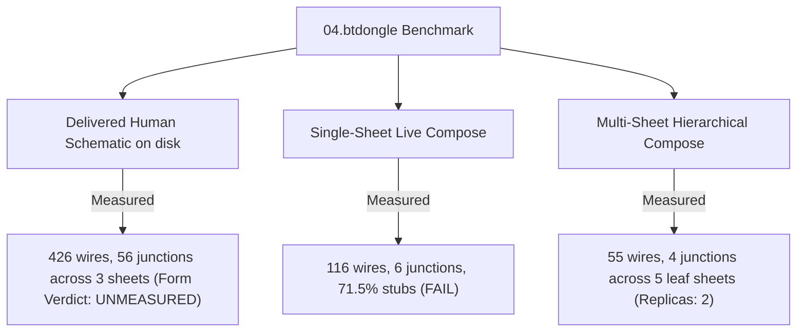

# P0.4 Readability Threshold Reconciliation Report

**Milestone**: Phase 1 (P0 Baseline Inventory, Suite Classification & Corpus Setup)  
**Task**: P0.4 / Section 1.4 in [tasks.md](file:///home/pkcs12/projects/bodesign/plans/eda-bridge_unified-collaborative-rebuild/tasks.md)  
**Date**: 2026-10-06  
**Status**: Completed  
**Rule Compliance**: Strict honesty. Legacy failed acceptance is NOT retroactively relabeled as passed. Scored subjects and population boundaries are explicitly disclosed.

---

## 1. Legacy Pinned Thresholds vs Calibration Run

From [`packages/eda-bridge/bodesign_eda_bridge/readability_gate.py`](file:///home/pkcs12/projects/bodesign/packages/eda-bridge/bodesign_eda_bridge/readability_gate.py):

| Metric | Code Operator & Threshold Constant | Passing Contract | Calibration Run (`MEASURE_RUN`) Measured Value | Calibration Verdict |
|---|---|---|---|---|
| **Junctions Emitted** | `if junctions <= MIN_JUNCTIONS:` (`MIN_JUNCTIONS = 20`) | `junctions > 20` | **6** (`6 <= 20`) | **FAIL** |
| **Stub Wire Share** | `elif stub_share >= MAX_STUB_SHARE:` (`MAX_STUB_SHARE = 0.40`) | `stub_share < 0.40` | **71.55%** (`0.715517 >= 0.40`) | **FAIL** |
| **Antifusion Downgrades** | `[d["net"] for d in downgrades if not (d.get("drawn_fragments") or 0)]` | `0` (or fragments > 0) | **3** downgrades recorded | **FAIL** |
| **Drawn Subcircuit Ratio** | `if ratio < MIN_SUBCIRCUIT_RATIO:` (`MIN_SUBCIRCUIT_RATIO = 0.50`) | `ratio >= 0.50` | **22.22%** (`4/18 = 0.2222 < 0.50`) | **FAIL** |
| **Overall Form Status** | `report["status"] = "failed" if unmet else "ok"` | All criteria met | **`failed`** (`READABILITY_THRESHOLD_UNMET`) | **FAIL** |

### Historical Calibration Run (`MEASURE_RUN`) Context
- **Spec Path**: `/home/pkcs12/products/thesmart_products/04.btdongle/C03-EE/02_build/sch_gen/design.py`
- **Spec Population**: 45 components, 27 canonical nets
- **Engine Flags**: `{'style': 'draftsman', 'validate': False, 'fidelity': False}`
- **Observed Metrics**:
  - `drawn_subcircuits`: 4
  - `N` (eligible subcircuit nets): 18
  - `subcircuit_ratio`: `0.2222`
  - `stub_share`: `71.55%`
  - `junctions`: 6
  - `fanout_proxy`: 7
  - `antifusion_downgrades`: 3

---

## 2. The Population Ambiguity & Scored Subject Disambiguation

A primary source of confusion in prior rounds (BR_20260906 §7) was conflating two completely different schematic populations under the name "btdongle":



1. **Delivered Human Schematic (`on-disk`)**:
   - Manually organized by human engineers across 3 sheets (`power`, `mcu`, `io`).
   - Counts: **426 wires**, **56 junctions**.
   - **Form Verdict**: **UNMEASURED**. Any prior claim of "PASS" is formally retracted. `readability_gate.py` **CANNOT score this today**: it has no S-expression reader for `.kicad_sch` files on disk; its input is `route_stats` generated solely by in-memory compose runs. `SUBJECT_ON_DISK` remains declared but structurally unreachable. Stating a gate PASS on an unscored on-disk file contradicts the gate's own invariant.
2. **Automated Flat Single-Sheet Compose (`live-compose`)**:
   - Emitted by the flat `draftsman` composer.
   - Counts: **116 wires**, **6 junctions**, **71.55% stub share**.
   - Result: Clear **FAIL**. Trying to force 45 components onto a single sheet results in label sprawl with isolated stubs.
3. **Automated Hierarchical Multi-Sheet Compose (`hierarchical.py`)**:
   - Re-architected in `experiments/btdongle_multisheet_e2e.py` into root + 5 leaf sheets (`usbc`, `power_rail`, `battery`, `charge_enable`, `mcu_swd`).
   - Counts: **55 wire runs**, **4 junctions**, **47 drawn instances** (45 canonical + 2 replica symbols of `U1`).
   - Cross-sheet nets are routed as local subsystem wires with continuation labels.
   - Verified by native `kicad-cli sch export netlist` with **zero electrical netlist divergence** (58 node classes matched exactly).

---

## 3. Threshold Reconciliation Invariants & Directives

1. **No Retroactive Relabeling (DD-1 / DD-7)**:
   - The flat live-compose result on `btdongle` is genuinely unreadable (a label farm) and **failed**. It must not be retroactively softened to "pass" or "acceptable".
2. **Form vs Electrical Decoupling (DD-2 / DD-5)**:
   - Readability gate evaluates strictly the `form` axis.
   - Every single report must continue to emit:
     ```python
     "does_not_authorize": ["electrical_correctness", "fidelity"]
     ```
   - An open-circuit drawing can achieve high aesthetic marks; the form gate must never be treated as proof of circuit correctness.
3. **Multi-Sheet Gate Calibration for Phase 2 / P2**:
   - The legacy thresholds (`MIN_JUNCTIONS = 20`, `MAX_STUB_SHARE = 0.40`) were calibrated against a single-sheet drawing attempt.
   - For hierarchical schematics, each leaf sheet represents an isolated subsystem view where net fanout across sheets is legitimately handled by continuation labels. Readability metrics in Phase 2 must evaluate per-view density rather than summing across decoupled pages.
