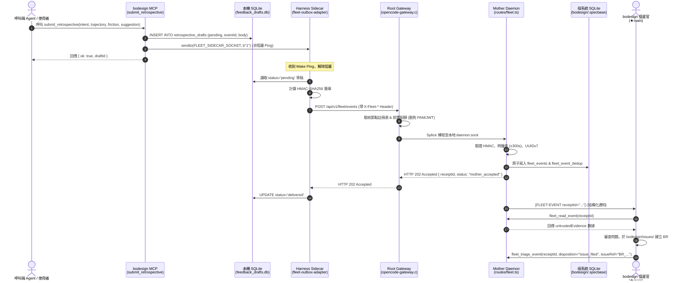

# Proposal: mcp_fleet-telemetry-feedback

_語言：[zh-hant](./) · **en**_

> Auto-generated index for the `mcp_fleet-telemetry-feedback` topic. Edit the source files; this README mirrors them. Do not edit this file directly.

## Status

**Proposed** · 1 history entries · last advance 2026-10-10 (mode `new` from (initial))

## Source artifacts

- [`proposal.md`](./proposal.md) — why this exists · modified 2026-10-10
- [`design.md`](./design.md) — architecture & decisions · modified 2026-10-10
- [`tasks.md`](./tasks.md) — checklist · 0/8 done (0%) · modified 2026-10-10
- [`idef0.json`](./idef0.json) + _no SVGs yet_ — formal functional decomposition
- [`grafcet.json`](./grafcet.json) + _no SVGs yet_ — formal runtime behavior
- `.state.json` — lifecycle state machine

## Why (excerpt)

bodesign 是負責硬體與電路設計（C00–C07 PCB 設計生命週期）的專用 MCP 服務器。使用者與 AI Agent 在呼叫各項硬體設計工具（如符號生成、線路合成、自動繞線、網表與三維渲染）時，若遭遇幾何錯誤、規格矛盾、工具異常或設計阻礙，亟需標準化機制讓呼叫端 Agent 能在第一時間將錯誤歷程與摩擦點（Friction）結構化上報給 bodesign 倉庫開發團隊。

藉由套用 OpenCode 全域艦隊遙測回饋架構（Fleet Telemetry & Retrospective Feedback，規範於 `specs/mcp-fleet-telemetry.md` 與 `mcp-builder/SKILL.md`），bodesign 能以「零網路侵入、零金鑰洩漏、被動推播」的純淨架構實現即時回報，並對接母系統 Ingress 將覆盤通知精確派發至 bodesign 在席值星官（`★main`），實現自動化立案與除錯閉環。

[Full →](./proposal.md)

## Architecture overview

[Full design →](./design.md)

## Recent activity

- 2026-10-10: `new` (initial) → proposed — initial spec created via plan-init.ts (profile=software)

<!-- AUTO-GENERATED by plan-builder MCP plan_sync · 2026-10-10T05:38:59Z · do not edit this file. -->
