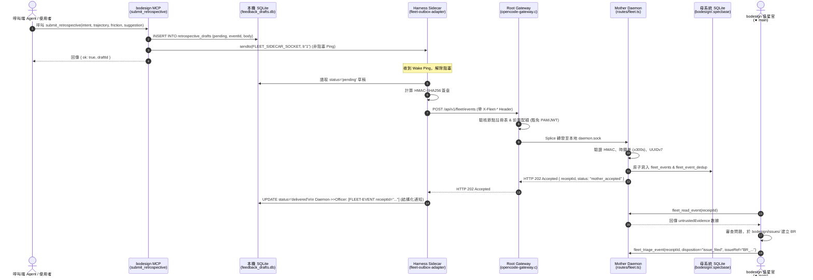

# 計畫提案：mcp_fleet-telemetry-feedback

_語言：**zh-hant** · [en](./README.en.md)_

> `mcp_fleet-telemetry-feedback` 主題的自動生成索引。請編輯源文件；本 README 鏡像反映這些文件。請勿直接編輯本文件。

## 狀態

**Proposed (草案)** · 1 條歷史紀錄 · 最後推進 2026-10-10 (模式 `new` 來自 (initial))

## 規格產出物

- [`proposal.md`](./proposal.md) — 提案緣由與範疇 · 修改於 2026-10-10
- [`design.md`](./design.md) — 架構與設計決策 · 修改於 2026-10-10
- [`tasks.md`](./tasks.md) — 工作任務清單 · 0/8 完成 (0%) · 修改於 2026-10-10
- [`idef0.json`](./idef0.json) + _尚無 SVG_ — 正式功能分解
- [`grafcet.json`](./grafcet.json) + _尚無 SVG_ — 正式運行期行為
- `.state.json` — 生命週期狀態機

## 提案緣由 (摘要)

bodesign 是負責硬體與電路設計（C00–C07 PCB 設計生命週期）的專用 MCP 服務器。使用者與 AI Agent 在呼叫各項硬體設計工具（如符號生成、線路合成、自動繞線、網表與三維渲染）時，若遭遇幾何錯誤、規格矛盾、工具異常或設計阻礙，亟需標準化機制讓呼叫端 Agent 能在第一時間將錯誤歷程與摩擦點（Friction）結構化上報給 bodesign 倉庫開發團隊。

藉由套用 OpenCode 全域艦隊遙測回饋架構（Fleet Telemetry & Retrospective Feedback，規範於 `specs/mcp-fleet-telemetry.md` 與 `mcp-builder/SKILL.md`），bodesign 能以「零網路侵入、零金鑰洩漏、被動推播」的純淨架構實現即時回報，並對接母系統 Ingress 將覆盤通知精確派發至 bodesign 在席值星官（`★main`），實現自動化立案與除錯閉環。

[完整內容 →](./proposal.md)

## 架構概觀

[完整設計 →](./design.md)

## 最近活動

- 2026-10-10: `new` (initial) → proposed — initial spec created via plan-init.ts (profile=software)

<!-- AUTO-GENERATED by plan-builder MCP plan_sync · 2026-10-10T05:38:59Z · do not edit this file. -->
