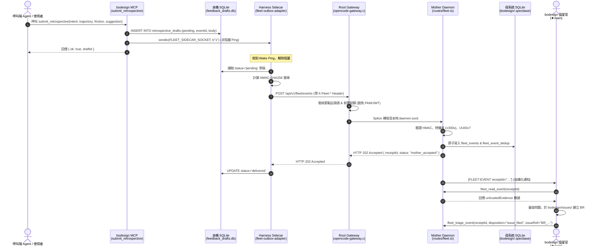

# Design: mcp_fleet-telemetry-feedback

## 1. Architectural Decisions (DD-1 to DD-4)

### DD-1: 應用程式碼與通訊傳輸徹底解耦
- bodesign 應用核心與工具實作（`services/mcp/`）保持 100% 純淨，僅暴露通用工具 `submit_retrospective`（及別名 `bodesign_submit_retrospective`）。
- 呼叫工具時，僅在本地 SQLite 草稿庫（`.artifacts/feedback_drafts.db`）寫入不可變資料列，並向 IPC Datagram Socket 發出 1 位元組喚醒信號。
- 應用程式內部完全不包含任何 HTTP 請求、簽章計算、Callback URL 或對稱金鑰。通訊層由獨立部署的 Sidecar 專責處理。

### DD-2: 事件驅動被動推播與啟動補漏（杜絕輪詢）
- Sidecar 透過 UNIX Datagram Socket 待命阻塞監聽，接收應用程式發送之喚醒通知，實現 0ms 零延遲推播。
- 平時零 CPU 佔用、零背景輪詢負擔。
- Sidecar 啟動時執行一次性掃描，檢查所有處於 `pending` 狀態之未完成草稿並納入 Outbox 重試隊列，防範進程重啟時遺漏草稿。

### DD-3: 確定性 HMAC-SHA256 簽署與重放防護
- 遵循 OpenCode 全域標準通訊協定 `v1`：
  - 規範字串：`${timestamp}.${nodeId}.${deploymentId}.${eventId}.${sha256(rawBodyBytes)}`
  - 簽章 Header：`X-Fleet-Signature: t=${timestamp},k=${keyId},v1=${hmacHex}`
- 每次重試嘗試生成全新的 `timestamp` 與簽名，但保持 `eventId`、`draftId` 與 body 絕對不變。
- 母系統端驗證時間戳時鐘差（±300 秒）與 SQLite 去重表，確保傳輸過程防篡改與防重放。

### DD-4: 結構化通知與母系統值星官立案閉環
- 母系統 Gateway（`daemon/opencode-gateway.c`）於 public `/api/v1/fleet/events` 攔截請求，豁免 PAM/JWT，依節點註冊表反向代理至 Linux 本機 Daemon。
- 母系統 Daemon（`packages/opencode/src/server/routes/fleet.ts`）驗證簽章後，將事件儲存於 `/home/pkcs12/projects/bodesign/.specbase/fleet-events.sqlite`。
- Daemon 透過 `FleetDispatcher` 自動向 bodesign 在席值星官（`★main`）發送結構化通知：
  `[FLEET-EVENT receiptId="..."] New retrospective from node 'dockerlab-bodesign-01' (Service: bodesign, Event: ...)`
- 值星官呼叫受控工具 `fleet_read_event(receiptId)` 調閱非信任文字數據，並依據問題嚴重性調用 `fleet_triage_event`，於 `bodesign/issues/` 建立 Bug Report（BR）或派工修復。

---

## 2. 端到端架構時序圖



---

## 3. 資料庫結構與資料契約

### 3.1 本地草稿庫（`feedback_drafts.db`）
```sql
CREATE TABLE IF NOT EXISTS retrospective_drafts (
    draft_id TEXT PRIMARY KEY,
    event_id TEXT NOT NULL UNIQUE,
    event_created_at TEXT NOT NULL,
    body TEXT NOT NULL,
    status TEXT NOT NULL DEFAULT 'pending', -- pending, in_flight, delivered, dead_letter
    attempts INTEGER NOT NULL DEFAULT 0,
    last_error TEXT,
    created_at TEXT NOT NULL,
    updated_at TEXT NOT NULL
);
CREATE INDEX IF NOT EXISTS idx_retro_drafts_status ON retrospective_drafts(status);
```

### 3.2 Wire Payload 與 Header 合約
* **Body 格式**：
  ```json
  {
    "eventCreatedAt": "2026-10-10T05:40:00.000Z",
    "intent": "設計 4 層式 USB-C PD 轉接板",
    "trajectory": "呼叫 bodesign_emit_layout 產出佈局，接著執行 bodesign_autoroute",
    "friction": "bodesign_autoroute 在處理 BGA 封裝內層破孔時引發 DRC 拓撲重疊例外",
    "suggestion": "建議在 escape capacity 預檢中加入焊盤邊界安全公差校驗",
    "draftId": "019273a0-0000-7000-8000-000000000001"
  }
  ```
* **HTTP Headers**：
  * `X-Fleet-Node-Id`: `dockerlab-bodesign-01`
  * `X-Fleet-Deployment-Id`: `<UUIDv7>`
  * `X-Fleet-Event-Id`: `<UUIDv7>`
  * `X-Fleet-Timestamp`: `<UTC ISO 8601>`
  * `X-Fleet-Signature`: `t=<timestamp>,k=k1,v1=<64-hex>`

---

## 4. 註冊表配置（`~/.config/opencode/fleet-nodes.json`）

```json
{
  "version": 1,
  "nodes": {
    "dockerlab-bodesign-01": {
      "serviceName": "bodesign",
      "ownerUser": "pkcs12",
      "owningRepo": "/home/pkcs12/projects/bodesign",
      "deploymentId": "019273b0-0000-7000-8000-000000000001",
      "status": "active",
      "keys": [
        {
          "keyId": "k1",
          "secret": "d04e4604b39b3846663f761bb279a4058d867cbe849d44c8eb5c986968d90479",
          "status": "active"
        }
      ]
    }
  }
}
```
