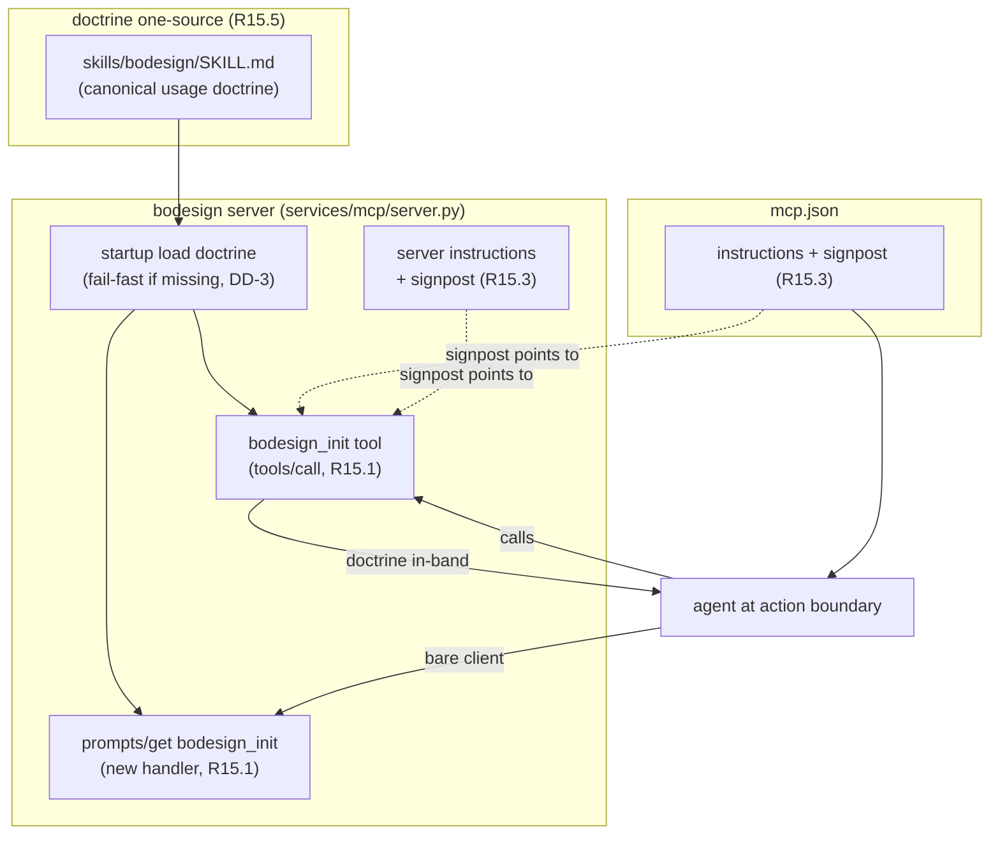

# Design: mcp_r15-self-describing-guide

## Context

bodesign 是 fleet MCP 標準 `mcp-integration-standard` 的 conformant adopter。標準
2026-07-07 extend 增訂 R15（self-describing organism / in-band usage guidance）為
MUST：每個 conformant service 必須主動在 portable MCP surface 自述 usage doctrine。
本 plan 由 docxmcp reference plan 複製而來，做 bodesign-specific 落地。

bodesign 現況（recon 2026-07-07）：

- `mcp.json`（`/home/pkcs12/projects/bodesign/mcp.json`）`id: bodesign`；有 instructions
  欄位（UDS + TCP dual transport），**但無 R15.3 guide signpost 句**。
- MCP server 主檔 `services/mcp/server.py`；**無 prompts/get handler**（需新建，異於
  docxmcp 已有 curated SOP prompts）。
- companion skill `skills/bodesign/SKILL.md`（15 章節，C00–C07 lifecycle，"How to use
  this skill" 起）= R15 要投影的 doctrine source。
- 尚無 `bodesign_init` tool。

因此 R15 對 bodesign 的 delta：加 guide tool、**新建 prompts handler** 並加 R15 entry、
補 signpost、建 one-source 投影機制。

## Goals / Non-Goals

**Goals**

- `bodesign_init` MCP tool 回傳完整 usage doctrine（R15.1 tool 面）。
- `prompts/get bodesign_init` 回傳同源 doctrine（R15.1 prompts 面，bare-client
  portable；需新建 handler）。
- `instructions` + server instructions 補 signpost（R15.3）。
- doctrine 單一來源投影，杜絕三份漂移（R15.5）。

**Non-Goals**

- 不改既有 tools 行為；不重寫 bodesign SKILL.md 內容。
- 不引入 host load-gate（R15.4 禁）、不注入 conversational nudge（天條 2）。

## Decisions

- **DD-1 (dual-protocol 同源投影)**：`bodesign_init` tool 與 `prompts/get`
  `bodesign_init` entry 都從**同一份 doctrine 來源**投影，二者回傳 byte-identical 的
  doctrine 文本。拒絕手維護兩份（R15.5 要杜絕的漂移）。

- **DD-2 (doctrine 來源 = SKILL.md 為權威 source)**：**選定：直接以
  `skills/bodesign/SKILL.md` 為 source**（最小改動、天然與 companion skill 同源）。
  若 SKILL.md 含非 doctrine 章節，退而抽 doctrine 核心段成獨立檔——實作期依 SKILL.md
  實際內容定，記錄為 DD-2a。

- **DD-3 (讀取時機 = 啟動時載入 + 缺檔 fail fast)**：server 啟動時讀 doctrine 檔到
  記憶體常數。檔案缺失/空 → 啟動 fail fast（天條 11：無 doctrine 的 guide = no
  contract）。確認 `Dockerfile` COPY `skills/` 進 image。

- **DD-4 (signpost 措辭，service-authored 非 nudge)**：在 `mcp.json.instructions`
  與 server instructions 各補一句：
  `"USAGE GUIDE: this service self-ships its full usage doctrine — call bodesign_init (or prompts/get bodesign_init) for organ-coordination, cross-tool tradeoffs, pre-call disciplines, and gotchas before first use."`
  service 自己的 manifest 宣告，走既有 instructions rail，不注入對話流（與天條 2 的
  host `<system-reminder>` 注入範疇區隔）。

- **DD-5 (guide tool 註冊形態)**：`bodesign_init` 註冊為標準 MCP tool，
  `annotations: {readOnlyHint:true, destructiveHint:false, idempotentHint:true, openWorldHint:false}`，
  無 input 參數（或可選 `section` 過濾，實作期定）。`bodesign_` prefix 慣例一致。

- **DD-6 (新建 prompts handler)**：bodesign 現無 prompts/get handler，需在
  `services/mcp/server.py` 新建 `prompts/list`+`prompts/get`（至少含 R15 guide entry）。
  異於 docxmcp（已有 curated prompts、只需擴充）。範本：docxmcp `bin/mcp_server.py`。

## Risks / Trade-offs

- **R1 — doctrine 檔過大灌爆 tool result / prompt**：mitigation：若超量，DD-2 退回抽
  doctrine 核心段；guide 承載 R15.2 四類，非整份 SKILL。
- **R2 — SKILL.md 在 container image 內缺失**：mitigation：DD-3 啟動 fail fast + 確認
  Dockerfile COPY skills/。
- **R3 — 新建 prompts handler 需符合 MCP spec**：mitigation：比照 docxmcp
  `bin/mcp_server.py` 的 prompts/list+prompts/get 實作為範本。

## Critical Files

- `/home/pkcs12/projects/bodesign/services/mcp/server.py` — 註冊 guide tool + 新建
  prompts handler + 補 server instructions signpost（tool 註冊入口）。
- `/home/pkcs12/projects/bodesign/mcp.json` — `instructions` 補 signpost。
- `/home/pkcs12/projects/bodesign/skills/bodesign/SKILL.md` — doctrine one-source。
- `/home/pkcs12/projects/bodesign/Dockerfile` — 確認 skills/ COPY 進 image。
- `/home/pkcs12/projects/opencode/specs/mcp-integration-standard/standard.md` — R15
  條文 + §13 checklist（驗收對照）。

## Architecture

Flow：companion skill SKILL.md 是 doctrine 唯一權威 → server 啟動時載入 → guide tool
與 prompts entry 同源投影 → instructions signpost 指向 guide → agent 在 action
boundary 依 signpost 呼叫 guide → doctrine 以 tool result 就地遞送（delivered
context）。
