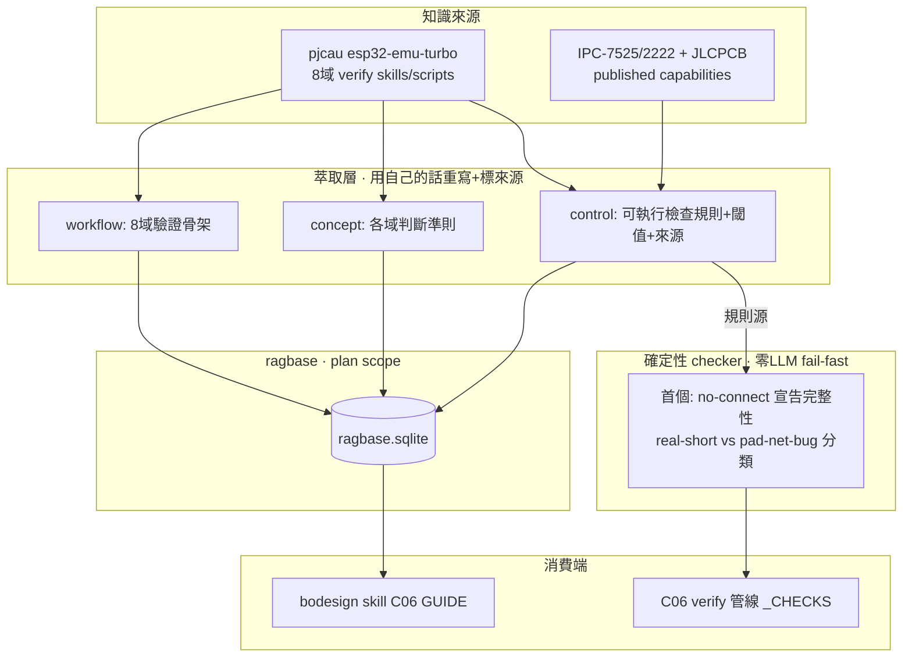

# Design: quality_verify-knowledge-hardening

## Context

bodesign 的 PRD→Gerber 管線已實證可跑（`specs/validation/prd-to-gerber-e2e/`），但驗證判斷力停在「DRC gate + G7 crosscheck 骨架」。缺的是系統化的「設計對錯判斷知識」——工程師憑經驗逐項檢查的那套規則（decap 夠不夠近、power trace 夠不夠寬、no-connect 是不是刻意、pin→net 是否對得上 datasheet）。

爬取 `pjcau/esp32-emu-turbo`（mcpmarket pcb-design-auditor 真身）取得一整套 verify 導向 skill/腳本，但其 code 是 project-specific 硬編 + 無 LICENSE，不可搬。其**知識**（8 域分類法、JLCPCB/IPC 製造規則數值、pin→net SSOT 模式、擺後檢查規則）是公開工程知識，可萃取重寫。使用者拍板：以「教 bodesign 判斷對錯」為目標，走知識萃取 + 確定性 checker 路徑。

## Goals / Non-Goals

**Goals**

- 建立 8 域 PCB 驗證判斷知識庫（ragbase），帶標準來源錨點，供 checker + skill 引用。
- 落地首個確定性 checker，證明「知識→確定性工具」路徑可行（零 LLM、fail-fast）。
- 知識物件結構化到可被 C06 verify 階段與 workflow-core 驗證管線消費。

**Non-Goals**

- 不搬 pjcau 的 project-specific code、不複製其原文。
- 不做 8 域全部 checker（本案立方法 + 首個示範）。
- 不做 G3 擺件生成（另案）；本案只供擺後**檢查**規則。

## Decisions

- DD-1: **知識萃取而非 code 移植**。pjcau 腳本硬編 `/Users/...` + 寫死 30 零件 + 無 LICENSE（保留所有權利）。萃取對象限縮為「公開製造能力數值 + 方法論分類」，用自己的話重寫並標來源錨點（IPC-7525 / IPC-2222 / JLCPCB published capabilities / skill 名）。拒絕方案：直接 vendor 其 `verify_*.py`（法律風險 + 死碼）。
- DD-2: **知識落 ragbase 三類物件**。`workflow`=8 域驗證流程骨架；`concept`=每域的判斷準則（decap-adequacy / power-path / no-connect-intent / pin-net-ssot…）；`control`=可執行檢查規則（帶閾值 + 來源）。理由：對齊 bodesign 既有 ragbase schema（`concept/control/workflow/role/idef0` 已在用），checker 直接引 control 物件為規則源。
- DD-3: **首個 checker 選 T1 no-connect 宣告**（對位實測 friction，最小可驗證、不需重 toolchain）。pjcau `drc-audit` 的 real-short vs pad-net-bug 分類法 + no-connect 意圖宣告直接對位 bodesign T1 缺口（power-only USB-C 的 D+/D-/SBU 刻意 NC → ERC 永殘留）。落點 core（pure-python，解析 `.kicad_sch`/netlist，判斷 NC 宣告完整性）。備選：G3 擺後 decap 距離檢查（需 `.kicad_pcb` 幾何，落 ee worker，成本較高）——列為第二增量。
- DD-4: **checker 遵守天條**。缺欄位/缺 datasheet → fail-fast + 缺項清單，不以泛用預設續跑；閾值來源必須可追溯 control 物件；同輸入 byte-identical 輸出、零 LLM。

## Risks / Trade-offs

- 法律邊界誤判 — mitigation: 只萃取數值/方法，用自己的話重寫，標來源；不複製原文/code；proposal Constraints 明列。
- 萃取的 JLCPCB 規格值過期/廠商特定 — mitigation: control 物件標 `source` + `as_of`，checker 閾值可覆寫（廠商 profile），非寫死。
- 知識物件 schema 與既有 ragbase 漂移 — mitigation: 先 `ragbase_query` 盤點既有 concept/control schema 再 distill，對齊不新造。
- 首個 checker 落點與既有 core/worker 邊界不符 — mitigation: DD-3 選 pure-python 路徑落 core，避開 worker forwarding 複雜度。

## Critical Files

- `packages/workflow-core/` — 驗證管線與 C06 `_CHECKS` 聚合；首個 checker 若走 workflow 判斷落此。
- `packages/eda-bridge/` — KiCad adapter 邊界；解析 `.kicad_sch`/netlist 的 no-connect 宣告在此側。
- `services/mcp/server.py` — MCP 工具註冊（handler `_h_*` + schema），新 checker 工具兩處註冊。
- `.specbase/ragbase.sqlite` — 知識物件落點（plan scope）。
- `specs/validation/prd-to-gerber-e2e/research/` — T1-T8 / G3 / G4 實測缺口證據（checker 需求輸入）。
- `skills/bodesign/stages/` — C06 verify GUIDE，知識引用接線點。

## Architecture

