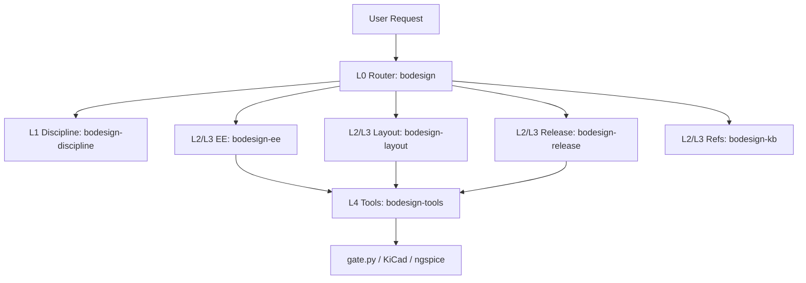

# Proposal: skills_a2a-modular-refactor

_語言：[zh-hant](./) · **en**_

> Auto-generated index for the `skills_a2a-modular-refactor` topic. Edit the source files; this README mirrors them. Do not edit this file directly.

## Status

**Verified** · 5 history entries · last advance 2026-10-21 (mode `promote` from implementing)

## Source artifacts

- [`proposal.md`](./proposal.md) — why this exists · modified 2026-10-21
- [`design.md`](./design.md) — architecture & decisions · modified 2026-10-21
- [`tasks.md`](./tasks.md) — checklist · 12/12 done (100%) · modified 2026-10-21
- `.state.json` — lifecycle state machine

## Why (excerpt)

The current bodesign skill (`skills/bodesign/SKILL.md`) is a 476-line monolith. It bundles routers, discipline rules, stage specifications, CLI syntax, and legacy tables into a single file. This design causes heavy cognitive load on agents (476 lines versus the 120-line budget in `skill-creator`).

Furthermore, the A2A production pipeline (`workflow_a2a-production-pipeline`) defined 6 specialized worker roles, but its bindings continued to point every role to the monolithic `bodesign` skill because modular skills did not exist. Finally, `lint-ste.py` reports 57 hard SCTE violations in `skills/bodesign/SKILL.md`.

Refactoring the skill system into layered, role-aligned skills resolves agent cognitive overload and aligns with the fleet-wide `skill-creator` standard.

[Full →](./proposal.md)

## Architecture overview

[Full design →](./design.md)

## Recent activity

- 2026-10-21: `promote` implementing → verified — All modular skills implemented, verified with lint-ste.py (0 hard violations), and projected cleanly
- 2026-10-21: `promote` planned → implementing — Starting implementation of modular skill extraction and SCTE cleanup
- 2026-10-21: `promote` designed → planned — Tasks breakdown and execution plan structured
- 2026-10-21: `promote` proposed → designed — Proposal and design completed for bodesign skills modular refactoring
- 2026-10-21: `new` (initial) → proposed — initial spec created via plan-init.ts (profile=docs)

<!-- AUTO-GENERATED by plan-builder MCP plan_sync · 2026-10-21T13:41:16Z · do not edit this file. -->
