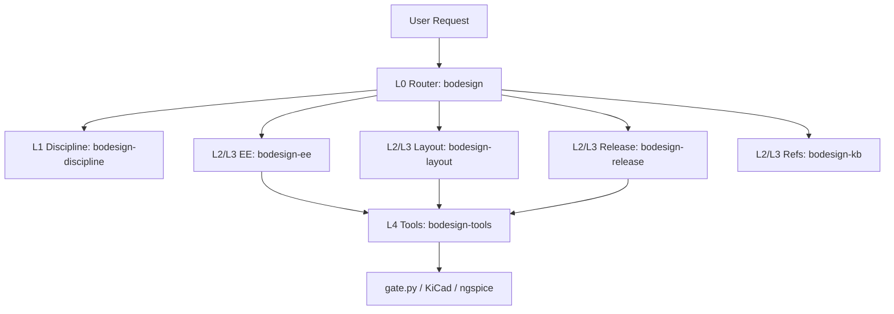

# Design: skills_a2a-modular-refactor

## Context

The current `skills/bodesign/SKILL.md` file contains 476 lines. It combines stage routers, honest deliverable models, CLI commands, and backward compatibility tables. When agents load this skill, instructions alone consume substantial context.

The A2A production pipeline (`workflow_a2a-production-pipeline`) established 6 discrete roles. However, because no granular skills existed, every worker had to load the entire monolithic `bodesign` skill. This violates the `skill-creator` standard and causes cognitive exhaustion.

## Goals / Non-Goals

**Goals**

- Decompose the single monolithic skill into 6 focused skills adhering to the Five-Layer Model.
- Keep every primary `SKILL.md` under 120 lines.
- Eliminate all 57 hard SCTE violations from skill files.
- Wire modular skills into the A2A execution contract in `bindings.json`.

**Non-Goals**

- Rewrite underlying Python packages in `packages/`.
- Change Docker images or deployment configurations.
- Alter MCP tool registration signatures.

## Decisions

- **DD-1: Five-Layer Skill Partitioning**:
  - L0 Router: `bodesign` (maps user intent to sub-skills).
  - L1 Discipline: `bodesign-discipline` (holds Honesty Model and DoD).
  - L2/L3 Role Skills: `bodesign-ee`, `bodesign-layout`, `bodesign-release` (specialized workflows).
  - L4 Tool: `bodesign-tools` (gate.py and CLI syntax).
- **DD-2: Progressive Disclosure for Stage Guides**:
  - Keep stage guides under `stages/` as reference documents.
  - Workers load only the guide relevant to their active step.
- **DD-3: Strict SCTE Compliance**:
  - Enforce zero semicolons, sentences under 25 words, and single active verbs.
  - Automated check via `/home/pkcs12/projects/opencode/script/lint-ste.py`.
- **DD-4: A2A Pipeline Bindings Alignment**:
  - Update `bindings.json` in `plans/workflow_a2a-production-pipeline/` to activate granular skills per role.

## Architecture

## Risks / Trade-offs

- **Risk: Breaking legacy skill triggers** — mitigation: The L0 `bodesign` router retains all primary triggers and routes immediately to the specialized skill.
- **Risk: Incomplete role coverage** — mitigation: Non-core stages (C01, C02, C05) continue to reference their existing stage guides via the L0 router.

## Critical Files

- `skills/bodesign/SKILL.md` — L0 router entrypoint.
- `skills/bodesign-discipline/SKILL.md` — L1 quality gate and honesty contract.
- `skills/bodesign-ee/SKILL.md` — L2/L3 schematic and circuit authoring.
- `skills/bodesign-layout/SKILL.md` — L2/L3 board layout and DRC.
- `skills/bodesign-release/SKILL.md` — L2/L3 manufacturing package release.
- `skills/bodesign-tools/SKILL.md` — L4 CLI landing verbs.
- `plans/workflow_a2a-production-pipeline/bindings.json` — A2A role activation manifest.
