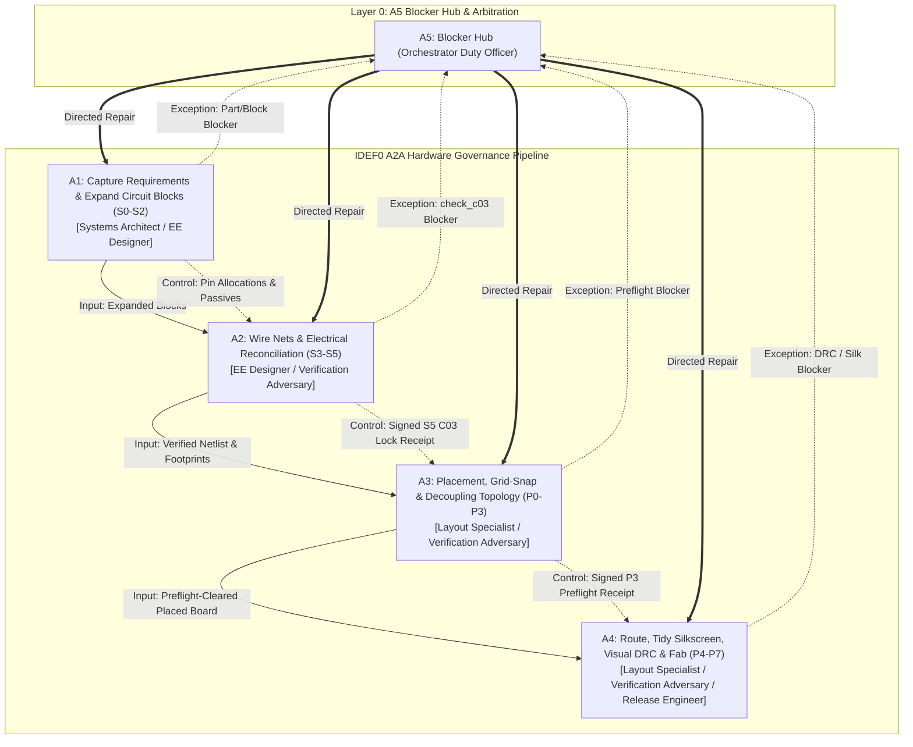

# Proposal: workflow_guarded-hardware-governance

_語言：[zh-hant](./) · **en**_

> Auto-generated index for the `workflow_guarded-hardware-governance` topic. Edit the source files; this README mirrors them. Do not edit this file directly.

## Status

**Verified** · 11 history entries · last advance 2026-10-23 (mode `sync` from (initial))

## Source artifacts

- [`proposal.md`](./proposal.md) — why this exists · modified 2026-10-22
- [`design.md`](./design.md) — architecture & decisions · modified 2026-10-22
- [`tasks.md`](./tasks.md) — checklist · 19/19 done (100%) · modified 2026-10-22
- [`idef0.json`](./idef0.json) + [idef0.A0.svg](./idef0.A0.svg) — formal functional decomposition
- [`grafcet.json`](./grafcet.json) + [grafcet.svg](./grafcet.svg) — formal runtime behavior
- `.state.json` — lifecycle state machine

## Why (excerpt)

Current AI hardware agents (including bodesign C03–C04 pipelines) frequently suffer from **state drift, coordinate hallucination, role conflation, and unconstrained action spaces** when conducting schematic capture and PCB layout. In complex board designs, without strict institutional guardrails:
1. LLM agents jump directly to routing before component placements or netlists are reconciled.
2. Authoring agents self-approve substandard designs due to lack of adversarial verification separation.
3. Minor pin-polarity or missing passive errors (e.g. absent feedforward capacitors, inverted common-anode LEDs) compound silently into unrecoverable routing failures.
4. When errors occur, agents engage in unauthorized, ad-hoc workarounds rather than structured exception escalation.

The open-source `zhoushoujianwork/easyeda-agent` demonstrates the power of Typed Actions, Micro-State Machines, and Circuit Blocks. This proposal elevates those technical primitives into a formal **IDEF0 A2A Institutional Regime (多 Agent 責任分層與制度治理體系)**:
- Establishing clean multi-agent labor division across 6 specialized roles.
- Enforcing upstream deliverables strictly as immutable `:control` constraints.
- Isolating adversarial verification into a dedicated `Verification Adversary`.
- Funneling all failures through a centralized `Blocker Hub (A5)` for directed repair.
- Mandatory cryptographic receipt handoffs disclosing unmeasured axes (`not_checked`).

[Full →](./proposal.md)

## Architecture overview

[Full design →](./design.md)

## Recent activity

- 2026-10-23: `sync` (initial) → undefined — post-task sync, clean
- 2026-10-22: `sync` (initial) → undefined — post-task sync, clean
- 2026-10-22: `promote` implementing → verified — All 19 tasks across Phases 1-5 implemented and verified by 33 tests in test suites
- 2026-10-22: `sync` (initial) → undefined — post-task sync, clean
- 2026-10-22: `sync` (initial) → undefined — post-task sync, clean

<!-- AUTO-GENERATED by plan-builder MCP plan_sync · 2026-10-23T09:45:40Z · do not edit this file. -->
