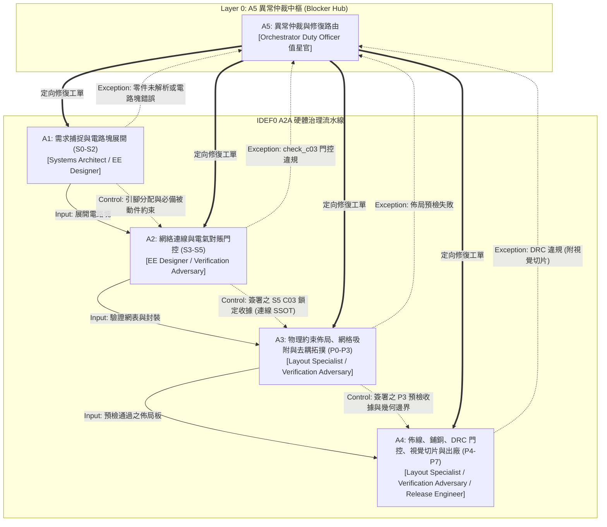

# 計畫：workflow_guarded-hardware-governance（IDEF0 A2A 制度化硬體設計治理工作流）

_語言：**zh-hant** · [en](./README.en.md)_

> `workflow_guarded-hardware-governance` 的索引文件。

## 狀態

**Verified（已驗證）** · 4 筆歷程記錄 · 最近推進：2026-10-23（由 implementing 推進至 verified）

## 原始工件

- [`proposal.md`](./proposal.md) — 提案背景與問題定義（IDEF0 A2A 制度化）
- [`design.md`](./design.md) — 架構與決策（DD-A2A-1 ~ DD-A2A-5）
- [`tasks.md`](./tasks.md) — 執行任務清單 · 19/19 完成 (100%)
- [`idef0.json`](./idef0.json) + [idef0.A0.svg](./idef0.A0.svg) — 形式化 5 活動 ICOM 功能分解模型
- [`grafcet.json`](./grafcet.json) + [grafcet.svg](./grafcet.svg) — 形式化 Blocker-Hub 執行期狀態機
- [`sequence.json`](./sequence.json) — 角色間時序交互合約
- [`data-schema.json`](./data-schema.json) — 資料綱要合約（收據、電路塊、阻斷紀錄）
- [`errors.md`](./errors.md) — 結果值域與錯誤目錄
- [`bindings.json`](./bindings.json) — 6 大角色會話綁定與啟用預算
- [`artifacts.json`](./artifacts.json) — 工件流向與產出者契約
- `.state.json` — 7 態生命週期狀態機

## 為什麼需要這項工作（IDEF0 A2A 制度）

當前的硬體 AI Agent（包括 bodesign 的 C03–C04 流水線）在進行原理圖繪製與 PCB 佈局時，經常面臨**狀態漂移、座標幻覺、權責混亂與未受約束的發散動作空間**。若缺乏正式的制度制度約束：
1. LLM Agent 容易在元件佈局或網表對賬尚未通過前，就冒進調用佈線工具。
2. 設計者同時擔任審查者，導致「自審自批」從而放過致命硬體缺陷。
3. 微小的引腳極性或缺失被動件會在後續無聲累積為不可逆的佈線災難。
4. 發生問題時，Agent 容易擅自嘗試未經授權的繞路修補，而非結構化回報。

開源項目 `zhoushoujianwork/easyeda-agent` 證明了強型別動作與微狀態機的威力。本計畫將其昇華為正式的 **IDEF0 A2A 制度體系（Multi-Agent Institutional Regime）**：
- **明確劃分 6 大專職角色**（Systems Architect, EE Designer, Layout Specialist, Verification Adversary, Release Engineer, Orchestrator Duty Officer）。
- **嚴格實施上游控制約定**：上游產物作為下游的 `:control`（不可變約束），下游絕對禁止修改上游契約。
- **獨立對抗式驗證**：驗證必須由專職的 Verification Adversary 執行，杜絕自審自批。
- **異常中樞（Blocker Hub, A5）統籌仲裁**：所有失敗產生結構化 `BLK-nnn.json`，由中樞統籌調度定向修復。
- **憑證收據手印與顯式揭露**：每次狀態轉移必須附帶數位收據，明確揭露 `not_checked` 未測軸線。

## 架構全景

