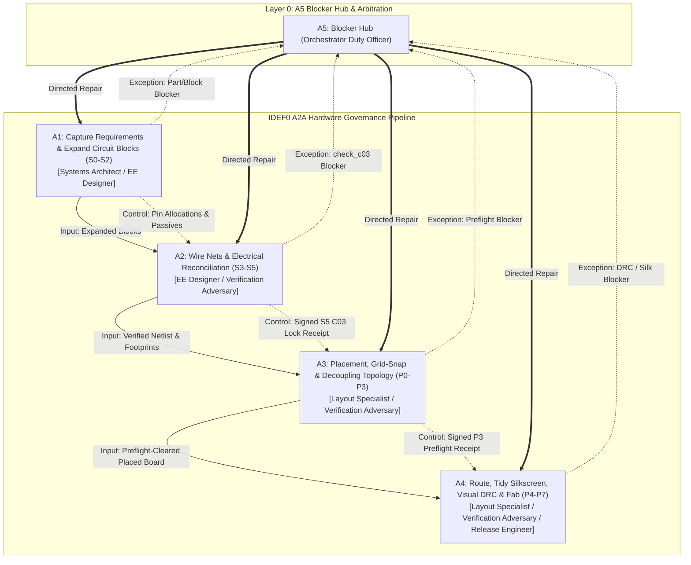

# Design: Governed Hardware Design Workflow under IDEF0 A2A Institutional Regime (C03-C04)

## Context

Hardware design with LLM agents frequently fails due to unconstrained search spaces, authority drift, and role conflation. While `easyeda-agent` introduced mechanical concepts like Typed Actions, Micro-State Machines, and Circuit Blocks, a true production-grade multi-agent system requires an **institutional framework** (IDEF0 A2A 制度) that codifies multi-agent labor division, authority boundaries, immutable control flows, and exception arbitration.

In `bodesign`, C03 represents Schematic Synthesis and C04 represents PCB Layout and Routing. This design elevates the micro-state and circuit-block concepts into a formal **IDEF0 A2A Institutional Regime**, ensuring that specialized agents operate within distinct constitutional boundaries, receive upstream artifacts strictly as immutable controls, hand off deliverables via cryptographic receipts, and resolve exceptions through a centralized Blocker Hub.

## Goals / Non-Goals

### Goals
- Formulate a strict **IDEF0 A2A Institutional Regime** governing 5 core activities (A1–A5) and 6 specialized agent roles.
- Enforce the **Upstream Control Invariant**: upstream engineering deliverables (e.g. frozen requirements, netlist SSOT) enter downstream activities strictly as `:control` constraints, preventing downstream agents from mutating upstream contracts.
- Isolate adversarial verification into a dedicated `Verification Adversary` role that independently executes deterministic gates (`check_c03`, `placement_preflight`, `layout_drc_gate`).
- Establish a centralized **Blocker-Hub Topology (A5)** for exception logging (`BLK-nnn.json`) and directed repair routing, prohibiting autonomous uncoordinated workarounds.
- Implement an immutable **Receipt Handoff Ledger** with explicit disclosure of unmeasured verification axes (`not_checked`).

### Non-Goals
- Modifying underlying EDA container toolchains or writing new KiCad C++ plugins.
- Allowing agents to self-approve or self-certify their own deliverables.

## Decisions

### DD-A2A-1: Multi-Agent Institutional Separation of Labor
- **Decision**: Define 6 distinct agent roles operating across 5 IDEF0 activities:
  1. `Systems Architect` (L1): Owns requirements capture, interface constraints, and C03 receipt sealing.
  2. `EE Designer` (L2): Owns component resolution, circuit block instantiation, and schematic wiring.
  3. `Layout Specialist` (L3): Owns physical placement, geometric tidy (`grid_snap`, `distribute_passives`), and routing.
  4. `Verification Adversary` (L4): Owns independent, zero-LLM adversarial auditing (`check_c03`, `placement_preflight`, `layout_drc_gate`, visual crops).
  5. `Release Engineer` (L5): Owns manufacturing fab package assembly, SHA-256 ledgering, and release sign-off.
  6. `Orchestrator Duty Officer` (L0): Owns the Blocker Hub (A5), triaging exceptions and routing repairs.
- **Rationale**: An agent that authors an artifact must never be the agent that verifies it (Zero Self-Approval Principle).

### DD-A2A-2: Upstream Artifacts as Immutable `:control` Constraints
- **Decision**: In `idef0.json`, the output of A1 (pin allocations, mandatory passives) enters A2 as `:control`. The output of A2 (signed S5 C03 receipt, netlist) enters A3 as `:control`. The output of A3 (preflight receipt, placement bounds) enters A4 as `:control`.
- **Rationale**: Downstream agents (e.g. Layout Specialist) must treat upstream netlists and keepout zones as rigid physics boundaries, strictly forbidding layout mutations that alter net connectivity or move frozen connectors.

### DD-A2A-3: Centralized Blocker-Hub Topology (A5)
- **Decision**: Any gate failure or prerequisite discrepancy immediately halts local execution, logs a structured `BLK-nnn.json` record, and hands off to Activity A5 (Blocker Hub). The Blocker Hub routes the repair directive back to the specific owning activity (e.g. DRC violation routed to A4 layout; missing passive routed to A2 schematic).
- **Rationale**: Enforces the global constitutional rule: *Out-of-Scope Blocker: Report, Do Not Act*. Prevents agents from guessing, patching foreign repos, or bypassing gates.

### DD-A2A-4: Cryptographic Receipt Handoff & Mechanical Pass Governance
- **Decision**: State transitions require a signed JSON receipt containing artifact SHA-256 hashes, gate verdicts, and explicit itemization of unmeasured axes (`not_checked`). Passing mechanical gates authorizes only `verdict: "MECHANICAL_PASS"`. Delivery-ready acceptance requires clean mechanical validation plus explicit human sign-off (天條 3).
- **Rationale**: Prevents premature claims of functional perfection while ensuring complete traceability.

### DD-A2A-5: Session Activation Budget & Handshake Contracts
- **Decision**: Every executable step declares a unique `session_binding` with explicit responsibility title (`Responsibility：Role`) and enforces activation budget `skills <= 2` and `capabilities <= 5`.
- **Rationale**: Prevents cognitive overload and prompt pollution in spawned agent sessions.

## Architecture & IDEF0 Functional Derivation

The architecture derives directly from the 5-activity IDEF0 skeleton (`idef0.json`):

- **Activity A1 (Capture Requirements & Expand Verified Circuit Blocks)**: Manages micro-states S0–S2. Resolves components and instantiates verified circuit blocks carrying mandatory passives and layout topology rules.
- **Activity A2 (Wire Nets & Enforce Deterministic Electrical Reconciliation)**: Manages micro-states S3–S5. Wires nets, runs `check_c03` (R1–R8), and seals the `S5_C03_LOCKED` state receipt.
- **Activity A3 (Engineer Physical Placement, Grid-Snap & Decoupling Topology)**: Manages micro-states P0–P3. Places footprints, runs `grid_snap` and `distribute_passives`, and verifies `placement_preflight`.
- **Activity A4 (Route, Tidy Silkscreen, Visual DRC Audit & Fab Release)**: Manages micro-states P4–P7. Routes nets, pours planes, runs `silk_tidy`, evaluates `layout_drc_gate` with visual crops, and releases the manufacturing package.
- **Activity A5 (Adjudicate Exceptions & Route Directed Repairs - Blocker Hub)**: The orchestration switchboard managing exceptions, logging `BLK-nnn.json`, and routing repairs back to A1–A4 without bypassing.

## Risks / Trade-offs

- **Risk**: Strict role isolation requires multiple session handoffs.
  - *Mitigation*: Session bindings enforce `reuse-first` so incumbent specialist sessions can be reactivated rather than spawning fresh unprimed contexts.
- **Risk**: Blocker hub loops if repairs fail repeatedly.
  - *Mitigation*: Blocker records enforce maximum retry limits (default 2), escalating to the operator if convergence is not achieved.

## Critical Files

- `idef0.json`: 5-activity ICOM decomposition and upstream control routing topology.
- `grafcet.json`: Blocker-hub execution state machine with divergence/convergence branches.
- `bindings.json`: 6-role session bindings, activation budgets, and validation adapters.
- `artifacts.json` & `data-schema.json`: Typed handshake data schemas (receipts, blocks, blockers).
- `errors.md`: Outcome codomain and error catalogue.
