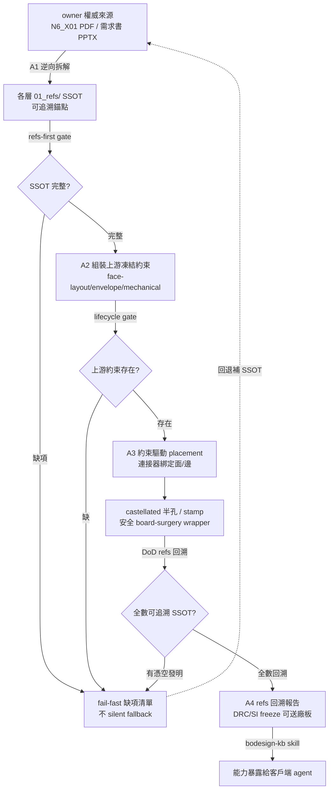

# Proposal: capability_refs-derived-design

_語言：[zh-hant](./) · **en**_

> Auto-generated index for the `refs-derived-design` topic. Edit the source files; this README mirrors them. Do not edit this file directly.

## Status

**Living** · 6 history entries · last advance 2026-07-04 (mode `promote` from verified)

## Source artifacts

- [`proposal.md`](./proposal.md) — why this exists · modified 2026-07-04
- [`design.md`](./design.md) — architecture & decisions · modified 2026-07-04
- [`tasks.md`](./tasks.md) — checklist · 25/25 done (100%) · modified 2026-07-04
- [`idef0.json`](./idef0.json) + [idef0.A0.svg](./idef0.A0.svg) — formal functional decomposition
- [`grafcet.json`](./grafcet.json) + [grafcet.svg](./grafcet.svg) — formal runtime behavior
- `.state.json` — lifecycle state machine

## Why (excerpt)

- bodesign 目前的 C00~C04 是「**從薄空氣生成 artifact**」範式：它假設物理決策、placement、腳位、元件清單都已由上游人工凍結，但**它自己既不提供產生這些決策的工具，也不強制設計必須回溯 owner 的權威 refs**。結果 agent 被迫憑空發明，產出「看似完整、實則造假」的交付物。
- 硬證據（aiguard N6_X01 真實模組）：owner 權威來源（說明文件 PDF + 正式需求書 PPTX）= 11 元件 / Stamp Hole X1(18)+X2(18)=36 pad dual-edge；agent 憑空發明版 = 8 元件（漏 WiFi/BT LBEE5KL1YN、Ethernet PHY RTL8211FI-CG、IMU LSM6DSMTR）/ 三面 28-pin。**座標、腳位數、元件清單全錯**。
- 這不是零星缺口，是**同一個範式錯誤的多個切面**（燒掉數十輪暴露）。aiguard C00-C07 專案已 **BLOCKING 暫停**，等 bodesign 完成核心能力翻轉後回來。
- 天條對齊：refs-derived 是「fail-fast + 顯式報錯 + 缺項清單」哲學的直接落地（repo 天條 2「No fabrication」、天條 1「No silent fallback」），把「憑空生成的假完整」擋在 gate 前。

[Full →](./proposal.md)

## Architecture overview

[Full design →](./design.md)

## Recent activity

- 2026-07-04: `promote` verified → living — core+worker 全達標 952 tests OK；使用者明確指示 graduate
- 2026-07-04: `promote` implementing → verified — core+worker 全達標 952 tests OK DRC roundtrip 實跑通過；使用者同意
- 2026-07-04: `promote` planned → implementing — fast-forward pass-through (burst implementation; all tasks checked + validation evidence): core+worker 全達標 952 tests OK DRC roundtrip 實跑通過；使用者同意
- 2026-07-04: `promote` designed → planned — tasks.md/handoff.md 齊備；spec/sequence/data-schema/test-vectors/errors/observability 全填實無 scaffold marker；planned gate PASS
- 2026-07-04: `promote` proposed → designed — proposal/design/idef0/grafcet/spec/sequence/data-schema 齊備且 drawmiat 驗證通過；EPIC 統攝 8 筆 session BR

<!-- AUTO-GENERATED by plan-builder MCP plan_sync · 2026-07-04T17:23:31Z · do not edit this file. -->
