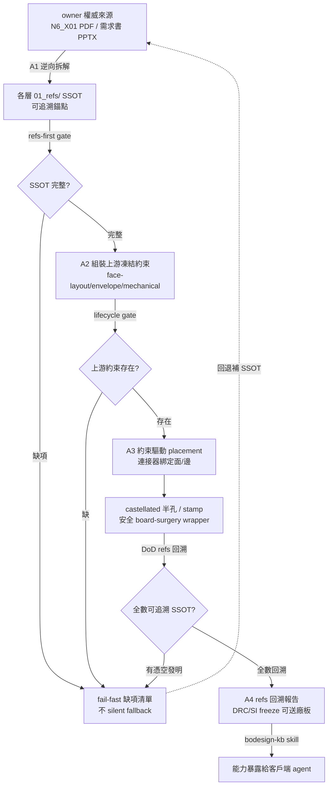

# Design: capability_refs-derived-design

## Context

bodesign 現況：C00~C04 生成 verb（52 landing + 40 compute）假設物理決策已由上游人工凍結，但工具鏈**既不提供產生決策的工具，也不強制回溯 owner 權威 refs**。三方獨立（orchestrator + 2 coding subagent）在 aiguard N6_X01 案燒掉數十輪，證實這是範式錯誤而非零星 bug：agent 憑空發明的 8 元件/三面 28-pin 版本，與 owner 權威來源的 11 元件/dual-edge 36-pad 全不符。aiguard 專案已 BLOCKING 暫停等此翻轉。

翻轉方向：**refs-derived 設計**——先逆向拆解 owner 權威來源 → 建各層 `01_refs/` SSOT → 下游 verb 只能消費、不能發明，缺 SSOT 則 fail-fast 拒絕。此設計骨架由 IDEF0（`idef0.json`，A1 拆解→A2 約束組裝→A3 約束驅動生成→A4 DoD 回溯驗證）與 GRAFCET（`grafcet.json`，10 步含 refs-gate/lifecycle-gate/DoD-gate 三處 fail-fast divergence + convergence 回退）定義，均通過 drawmiat 驗證。

## Goals / Non-Goals

**Goals**

- refs-first gate 強制化：無各層 `01_refs/` SSOT 時下游生成 verb fail-fast 拒絕（非 warn）。
- 約束驅動 placement：C04 消費 C01 face-layout + C02 envelope，連接器綁定面/邊。
- castellated / stamp-module 原生 verb + 安全 board-surgery wrapper（消滅徒手 pcbnew scripting）。
- lifecycle 方向性工具化：下游 verb 以上游凍結約束 JSON 為必要輸入。
- DoD 檢查涵蓋 refs 回溯；修 6 個 20260703 DoD 裂縫。
- ragbase 介面摩擦修（--help 契約 + 穩定 accessor）；`bodesign-kb` skill 暴露翻轉後能力。

**Non-Goals**

- 不重寫 aiguard（它是 consumer / 驗收案例，非本 plan 交付物）。
- 不追商用 EDA 級擺件品質；不做互動式 UI；不引入 RL/ML 擺件。
- 不折疊既有 `quality_deterministic-preplacement` plan（本 EPIC 只定義它消費的約束介面）。

## Decisions

- **DD-1: EPIC 傘狀 plan，統攝 8 筆 session BR，不逐點修補。** 使用者明確選「開完整 plan 涵蓋全 7 BR」。理由：8 筆 BR 是同一範式錯誤的多切面，逐點修補會漂移且無法收斂驗收。拒絕方案：只修切面 1 MVP（會讓其他切面各自為政）。
- **DD-2: refs-first gate 落 workflow-core（core / pure-python），非 worker。** 依 repo AGENTS.md §4，gate 檢查與約束組裝屬規劃/readiness（core）；placement/castellated/board-surgery 屬重 toolchain（ee worker）。理由：core 不可硬依賴 worker-only 套件；gate 必須在任何 worker forward 前先 fail-fast。
- **DD-3: SSOT 契約用各層 `01_refs/` 目錄 + fail-fast 前置檢查。** 下游 verb 進入前檢查 `01_refs/` 存在且可追溯 owner 錨點；不存在則回 typed error（非 warn、非 silent default）。對齊 repo 天條 1（No silent fallback）/ 天條 2（No fabrication）。
- **DD-4: 連接器面向/邊緣是上游凍結物理約束，非 C04 自由度。** placement 引擎讀 C01 face-layout（哪邊/哪面）綁定連接器，C04 不可移動。理由：「USB 插不進去」根因是 C04 發明了上游未凍結的面向決策。
- **DD-5: castellated PTH 半孔走 S-expression text-layer 注入 wrapper，禁 `fp.Reference().SetTextSize()` 等 segfault path。** 理由：切面 3 證實徒手 pcbnew scripting 必踩 SwigPyObject 二次 cast / GetFootprints 快取退化 segfault。
- **DD-6: aiguard 5 個既有 SSOT 為第一個真實驗收案例。** C01 物理配置 / C02 envelope / C03 元件腳位 / C04 物理約束 / C05 韌體腳位——翻轉達標 = 從這 5 SSOT 跑通全鏈且無任何憑空發明。
- **DD-7: gate.py stdout BR 已為 stale-mirror false-positive 關閉。** 本 repo `gate.py` 已符合契約（`_log`→stderr L47、envelope→stdout L52），無需改碼。切面 6 剩 ragbase id/query 摩擦。
- **DD-8: 既有 `quality_deterministic-preplacement` plan 為切面 2 子件，互補推進。** 那管「電氣感知擺件品質 vs grid 基線」，本 EPIC 管「約束來源與面/邊綁定」。本 plan 定義其消費的約束介面 JSON schema，不重造演算法。

## Risks / Trade-offs

- **範圍過大，單一 plan 難收斂** — mitigation: tasks.md 分階段（切面 1 refs-gate 為 P0 MVP + 驗收案例先行，切面 2-7 分批 planned），每階段以 aiguard SSOT 回歸。
- **約束 JSON schema 過早凍結致下游僵化** — mitigation: schema 設計帶版本 + 錨點欄位；先以 aiguard 真實案例驗證再泛化。
- **castellated S-expression 注入與 KiCad 版本耦合** — mitigation: wrapper 隔離 S-expression 細節，帶版本探測；DRC roundtrip 驗證。
- **DoD refs 回溯檢查成本高（每數字追溯）** — mitigation: 回溯用 SSOT 錨點索引，非全量重算；確定性可快取。

## Critical Files

- `packages/workflow-core/bodesign_workflow_core/` — refs-decomposition gate + 各層 `01_refs/` SSOT 契約 + lifecycle 上游約束讀取（core / pure-python）。
- `packages/eda-bridge/bodesign_eda_bridge/` — 約束驅動 placement 引擎 + castellated/stamp verb + 安全 board-surgery wrapper（ee worker）。
- `services/mcp/server.py` — 新 verb 的 handler `_h_*` + schema list（refs gate、placement、castellated/stamp）。
- `skills/bodesign/scripts/gate.py` — DoD 檢查段升級為 refs 回溯（切面 5）。
- `skills/bodesign-kb/` — 新 skill，暴露翻轉後能力（切面 7）。
- `plans/quality_deterministic-preplacement/` — 切面 2 子件，本 plan 定義其約束介面。

## Architecture

