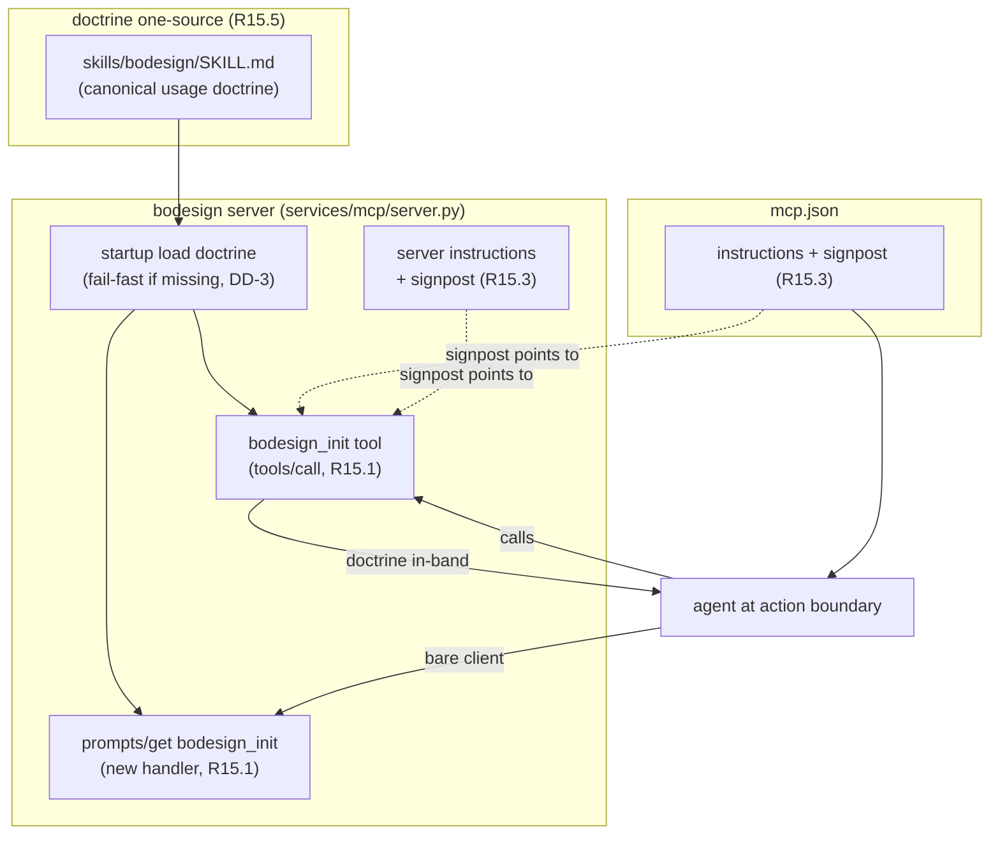

# Proposal: mcp_r15-self-describing-guide

_語言：[zh-hant](./) · **en**_

> Auto-generated index for the `mcp_r15-self-describing-guide` topic. Edit the source files; this README mirrors them. Do not edit this file directly.

## Status

**Living** · 4 history entries · last advance 2026-07-16 (mode `promote` from verified)

## Source artifacts

- [`proposal.md`](./proposal.md) — why this exists · modified 2026-07-07
- [`design.md`](./design.md) — architecture & decisions · modified 2026-07-11
- [`tasks.md`](./tasks.md) — checklist · 13/13 done (100%) · modified 2026-07-11
- [`idef0.json`](./idef0.json) + [idef0.A0.svg](./idef0.A0.svg) — formal functional decomposition
- [`grafcet.json`](./grafcet.json) + [grafcet.svg](./grafcet.svg) — formal runtime behavior
- `.state.json` — lifecycle state machine

## Why (excerpt)

- opencode 的 fleet MCP 標準 `mcp-integration-standard` 於 2026-07-07 extend 增訂
  **R15（self-describing organism / in-band usage guidance）** 為 MUST 條文。bodesign
  是 fleet conformant service，須採納 R15，複製 docxmcp reference pattern。
- 病根（R15 要治的 L3）：bodesign 的 usage doctrine（C00–C07 hardware product-design
  lifecycle、各 flow 選用、organ coordination）目前只活在 host-side prose —— companion
  skill `skills/bodesign/SKILL.md` + AGENTS.md 路由。模型必須主動載入且不能反射略過；
  經驗上會反射略過（confident-but-wrong prior 壓過 loaded prose）。R15 把 doctrine 放上
  portable MCP surface，以 tool result 形式在 action boundary 就地遞送 —— delivered
  context，非 remembered context。

[Full →](./proposal.md)

## Architecture overview

[Full design →](./design.md)

## Recent activity

- 2026-07-16: `promote` verified → living — 使用者明確裁決 2026-07-16：6 個 verified plan 全部畢業
- 2026-07-07: `migration` designed → verified — burst implementation: all tasks [x] with live UDS smoke evidence (tool+prompts byte-identical doctrine 11872 chars, signpost present, missing-doctrine fail-fast verified); R15.1-R15.5 §13 checklist passed. No standalone implementing window existed.
- 2026-07-07: `promote` proposed → designed — design.md + idef0.json + grafcet.json authored & validated (drawmiat OK); IDEF0 skeleton mapped in design
- 2026-07-07: `new` (initial) → proposed — initial spec created via plan-init.ts

<!-- AUTO-GENERATED by plan-builder MCP plan_sync · 2026-07-16T13:05:53Z · do not edit this file. -->
