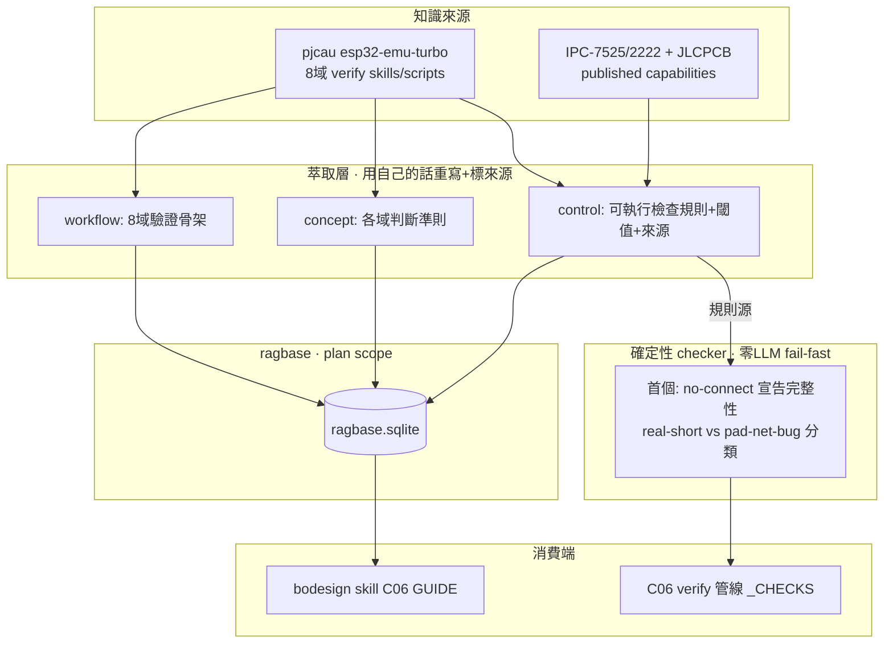

# Proposal: quality_verify-knowledge-hardening

_語言：[zh-hant](./) · **en**_

> Auto-generated index for the `verify-knowledge-hardening` topic. Edit the source files; this README mirrors them. Do not edit this file directly.

## Status

**Living** · 6 history entries · last advance 2026-07-04 (mode `promote` from verified)

## Source artifacts

- [`proposal.md`](./proposal.md) — why this exists · modified 2026-07-03
- [`design.md`](./design.md) — architecture & decisions · modified 2026-07-03
- [`tasks.md`](./tasks.md) — checklist · 12/12 done (100%) · modified 2026-07-03
- `.state.json` — lifecycle state machine

## Why (excerpt)

- bodesign PRD→Gerber 管線已實證走通（`specs/validation/prd-to-gerber-e2e/`），但**驗證判斷力薄弱**：C04-C06 只有 DRC gate + crosscheck 骨架，缺乏「像資深硬體工程師逐項判斷設計對錯」的系統化知識。三個實測缺口 G3（擺件品質無電氣感知）、G4（datasheet-grounded 冷啟動）、T1（no-connect 無法宣告）都指向同一根因：**bodesign 不會判斷「這個設計哪裡有問題」**。
- 爬取 mcpmarket `pcb-design-auditor` → 真身 GitHub `pjcau/esp32-emu-turbo`，發現一整套 40+ PCB verify skill + 80+ 確定性 `verify_*.py`，涵蓋 8 域驗證（power/signal/thermal/EMI/DFM/mechanical）、JLCPCB 完整製造規則、pin→net single-source-of-truth、擺後品質檢查。**它的價值是「教 bodesign 判斷對錯」的驗證知識**，正好命中 bodesign 核心哲學（展示可靠度＝確定性驗證，非宣稱）。

[Full →](./proposal.md)

## Architecture overview

[Full design →](./design.md)

## Recent activity

- 2026-07-04: `promote` verified → living — user-confirmed graduation：verified 12/12
- 2026-07-03: `promote` implementing → verified — 知識萃取5物件+首個ERC分類checker落地；17測試通過含真kicad-cli E2E；architecture同步
- 2026-07-03: `promote` planned → implementing — 開始知識萃取 + 首個 checker 實作
- 2026-07-03: `promote` designed → planned — tasks.md 完成（3 phase 12 item）；docs profile handoff optional
- 2026-07-03: `promote` proposed → designed — proposal+design(含Mermaid架構)完成；docs profile idef0/grafcet optional

<!-- AUTO-GENERATED by plan-builder MCP plan_sync · 2026-07-04T14:03:57Z · do not edit this file. -->
