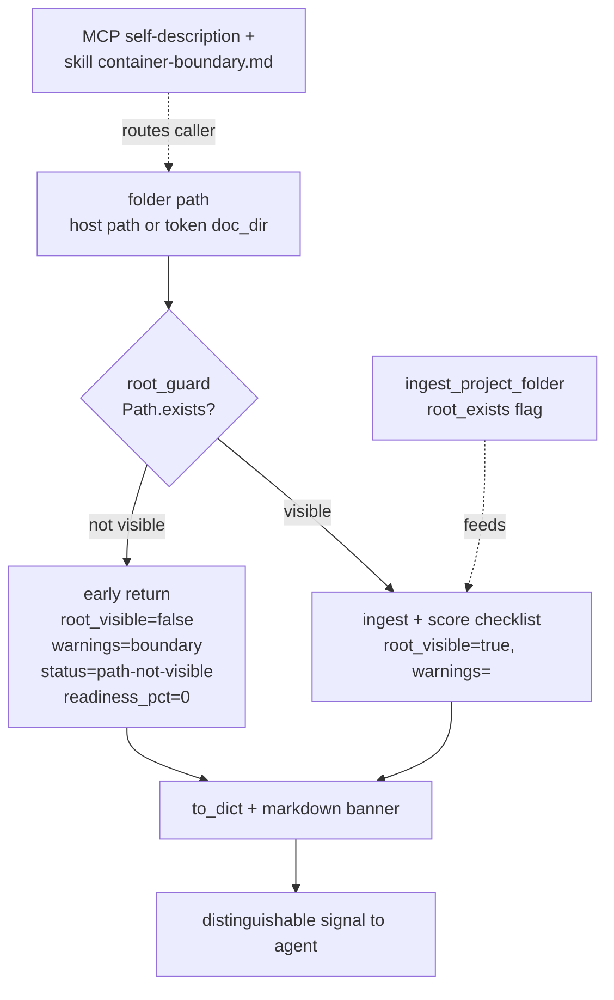

# Proposal: quality_readiness-fail-loud-on-invisible-path

_語言：[zh-hant](./) · **en**_

> Auto-generated index for the `quality_readiness-fail-loud-on-invisible-path` topic. Edit the source files; this README mirrors them. Do not edit this file directly.

## Status

**Living** · 6 history entries · last advance 2026-06-22 (mode `promote` from verified)

## Source artifacts

- [`proposal.md`](./proposal.md) — why this exists · modified 2026-06-22
- [`design.md`](./design.md) — architecture & decisions · modified 2026-06-22
- [`tasks.md`](./tasks.md) — checklist · 21/21 done (100%) · modified 2026-06-22
- [`idef0.json`](./idef0.json) + _no SVGs yet_ — formal functional decomposition
- [`grafcet.json`](./grafcet.json) + _no SVGs yet_ — formal runtime behavior
- `.state.json` — lifecycle state machine

## Why (excerpt)

- bodesign MCP runs inside a Docker container whose only mounts are `.run`, the sessions
  volume, and the vault volume. When a caller passes a **host path that is not mounted into the
  container** (e.g. a Google Drive FUSE mount, or simply a typo'd path), the readiness family
  does not fail — it returns a syntactically clean `readiness_pct: 0` with every deliverable
  `missing`, and silently drops the one warning that would have explained why.
- This is a direct violation of bodesign's honesty model ("never claim more than you can show")
  and the global fail-fast rule. A tool that *cannot see the folder* must not return a score that
  is indistinguishable from *the folder is genuinely empty*.
- Observed live: every `bodesign_*_readiness` call against
  `thesmart_products/01.openmv` returned 0%/missing while the files (e.g. a 2568-byte
  `Design_Direction.md`, a 29 KB `answer_state.json`) demonstrably exist on the host. An agent
  nearly concluded the entire portfolio was empty and needed full regeneration.

[Full →](./proposal.md)

## Architecture overview

[Full design →](./design.md)

## Recent activity

- 2026-06-22: `promote` verified → living — User-confirmed graduation (畢業). Verified: 9 unit tests + live MCP round-trip (invisible→root_visible:false, file-model→true scoring); full artifact set present.
- 2026-06-22: `promote` implementing → verified — All tasks checked. Evidence: 9 new unit tests green + unchanged c00 data-error test; full readiness regression passes (only pre-existing httpx/mcp_delegate env gaps). Live MCP round-trip: invisible path -> root_visible:false+warnings+boundary next_step; file-model tree -> root_visible:true real 67% scoring; pre-restart container reproduced the bug.
- 2026-06-22: `promote` planned → implementing — Implementation landed across ingest + readiness family + docs; tests green.
- 2026-06-22: `promote` designed → planned — tasks.md, handoff.md (Required Reads + Stop Gates In Force), errors.md, observability.md, test-vectors.json all present.
- 2026-06-22: `promote` proposed → designed — Design + contracts complete: spec.md (Purpose/Requirements/Scenarios/Acceptance), design.md headings, idef0/grafcet/sequence/data-schema authored and drawmiat-validated. DD-4 resolved.

## Cross-links

### Code anchors

- project_ingest.py:96-101 — silent-empty-return (root cause)
- package_readiness.py:108-127 — missing-from-empty propagation
- package_readiness.py:82-93 — to_dict drops warnings
- c00_prd_template.py:351-352 — fail-loud baseline (the contract to unify toward)

<!-- AUTO-GENERATED by plan-builder MCP plan_sync · 2026-06-22T17:40:17Z · do not edit this file. -->
