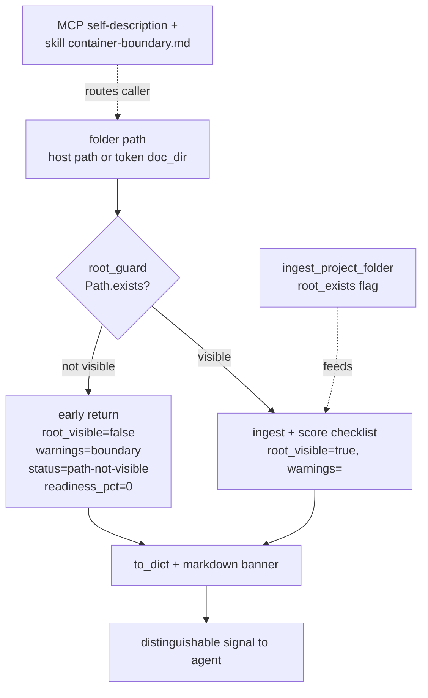

# Design: quality_readiness-fail-loud-on-invisible-path

## Context

bodesign MCP is a containerized service. The readiness family (`package_readiness` +
`c00..c06_readiness`) is the "compass" an agent reads each turn to decide what to produce. When the
caller passes a host path the container cannot see, the compass points to a false "empty" reading
instead of an error. This destroys the honesty guarantee the whole product rests on.

## Architecture

The single chokepoint is `root_guard` in `readiness_common.py`; every readiness entrypoint
(`package` + `c00..c06`) calls it first. Visible folders flow through unchanged scoring; an invisible
root short-circuits to the loud, distinguishable signal. See `idef0.json` / `grafcet.json` for the
formal decomposition and runtime flow.

## Goals / Non-Goals

### Goals

- A readiness call against a non-existent / not-visible root produces a **distinguishable** signal
  (error or explicit `root_visible: false` + warning), never a silent `readiness_pct: 0`.
- The ingest-layer "Folder not found" warning reaches MCP tool output.
- One consistent error contract across the readiness family.
- Container-boundary knowledge + file-model routing sedimented into skill + enablement + MCP
  self-description.

### Non-Goals

- Auto-mounting host paths; changing the scoring rubric; adding any silent retry/fallback.

## Root-cause evidence (code anchors)

- **`packages/reverse-core/bodesign_reverse_core/project_ingest.py:96-101`** — `ingest_project_folder`
  on `not base.exists()` appends a warning and returns an empty index (silent-empty-return). This is
  the root cause.
- **`packages/workflow-core/bodesign_workflow_core/package_readiness.py:108-127`** —
  `assess_package_readiness` starts from `ingest_project_folder`; empty `files` → every checklist
  item `missing` → `readiness_pct: 0`, with no awareness the folder was invisible.
- **`package_readiness.py:82-93`** — `PackageReadiness.to_dict()` output has **no `warnings` key**;
  the ingest warning is dropped before it can reach the caller.
- **`packages/workflow-core/bodesign_workflow_core/c01_id_package.py` `assess_c01_package_readiness`**
  — per-file `if not path.exists(): "missing"`; invisible root → blanket missing, no error.
- **`packages/workflow-core/bodesign_workflow_core/c00_prd_template.py:351-352`** —
  `assess_c00_prd_readiness` **raises** `C00TemplateError("C00 artifact not found")`. Proof the
  family is internally inconsistent: c00 fails loud, the rest fail silent.
- **Container boundary**: `docker inspect bodesign-pkcs12-bodesign-1` → mounts = `.run`, sessions
  vol, vault vol only. `docker exec ... ls <project path>` → `No such file or directory`. The host
  FUSE path is not in the container mount namespace.

## Decisions

- **DD-1**: Fix at the **contract layer**, not by re-mounting. Re-mounting the project into the
  container would mask the bug (a typo'd or genuinely-absent path must still fail loud). A mount
  change may be offered as an *operational convenience* but is never the correctness fix.
- **DD-2**: `ingest_project_folder` gains an explicit `root_exists: bool` on `ProjectFolderIndex`
  (default derived from `base.exists()`), and `to_dict()` surfaces it + `warnings`. Backward
  compatible: visible folders set `root_exists: true` and an empty `warnings` list.
- **DD-3**: Readiness outputs (`PackageReadiness.to_dict()` and each per-stage result `to_dict()`)
  add `warnings: list[str]` and `root_visible: bool`. When `root_visible` is false, `next_step`
  becomes a boundary-specific instruction ("folder not visible to the bodesign container — pass a
  mounted path or upload via the file model (tar → token → doc_dir)"), not a deliverable next step.
- **DD-4** (RESOLVED, implemented 2026-06-23): chose **(b) structured `root_visible: false`**,
  applied family-wide via the shared `root_guard` helper in `readiness_common.py`. An invisible
  root returns `{root_visible: false, warnings: [...], next_step: <boundary instruction>}` with a
  distinct `status: "path-not-visible"` where a status field exists; `ok: true` stays so the
  payload (not a transport error) carries the meaning. c00 is folded in: it now returns the
  structured form when the **root** is invisible, but **keeps raising** `C00TemplateError` when
  `answer_state.json` is genuinely missing inside a *visible* folder (artifact-missing is a real,
  loud, in-folder signal — distinct from root-invisibility). Existing test
  `test_run_tool_c00_readiness_missing_state_is_data_error` confirms that path is unchanged.
- **DD-5**: MCP self-description: replace "Tools also accept plain host paths for the local
  same-host UDS case" with a qualified statement — host paths only resolve if inside the container's
  mount namespace; otherwise use the file model. Add a big-tree note (exclude heavy binaries
  `.glb`/`viewer.html`/PNG/generated; readiness only needs text/json deliverables).
- **DD-6**: Skill + enablement: add a short "container boundary" reference so an agent never has to
  reverse-engineer it with `docker inspect`.

## Risks / Trade-offs

- **R1**: Touching `to_dict()` schemas could break downstream consumers that key on a fixed shape.
  Mitigation: additive only (new keys), existing keys unchanged; add test asserting visible-folder
  output is a superset of the old shape.
- **R2**: Over-broad raise could turn legitimate "partially built" folders into errors. Mitigation:
  the new signal triggers **only** on `not root.exists()` (root invisible), never on a present-but-
  incomplete folder.
- **R3**: Inconsistent application across the 6 per-stage functions. Mitigation: a shared helper
  `_root_guard(folder)` used by every readiness entrypoint.

## Critical files

- `packages/reverse-core/bodesign_reverse_core/project_ingest.py`
- `packages/workflow-core/bodesign_workflow_core/package_readiness.py`
- `packages/workflow-core/bodesign_workflow_core/c01_id_package.py`
- `packages/workflow-core/bodesign_workflow_core/c02_me_package.py`
- `packages/workflow-core/bodesign_workflow_core/c04_layout_constraints.py`
- `packages/workflow-core/bodesign_workflow_core/c05_fw_spec.py`
- `packages/workflow-core/bodesign_workflow_core/c06_test_plan.py`
- `packages/workflow-core/bodesign_workflow_core/c00_prd_template.py` (baseline reference)
- MCP server instructions / self-description (server entry)
- bodesign skill `SKILL.md` + a new `references/container-boundary.md`
- `prompts/enablement.json` (routing note)

## Code anchors

- project_ingest.py:96-101 — silent-empty-return (root cause)
- package_readiness.py:108-127 — missing-from-empty propagation
- package_readiness.py:82-93 — to_dict drops warnings
- c00_prd_template.py:351-352 — fail-loud baseline (the contract to unify toward)
